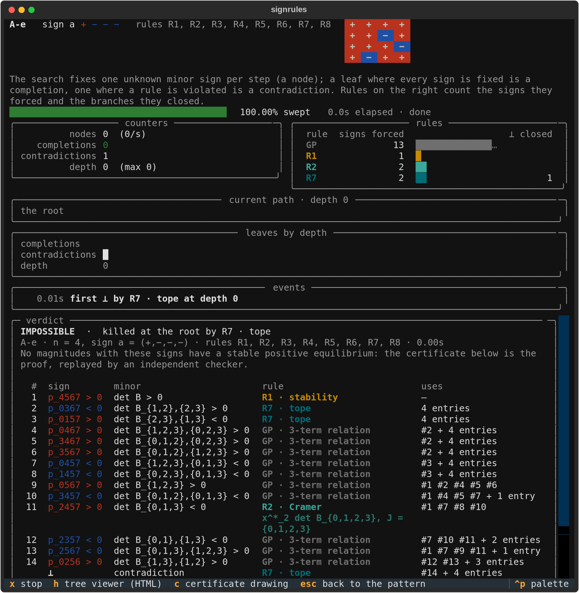

# signrules

[](https://github.com/gescholt/signrules/actions/workflows/ci.yml)
[](https://doi.org/10.5281/zenodo.24214426)

A Python package that proves Lotka–Volterra sign patterns **impossible**, with a machine certificate for
every proof and an independent checker that replays it.

A Lotka–Volterra community `ẋ = diag(x)(a − Bx)` is described qualitatively by a *sign pattern*: the signs
of the growth rates `a` and of the interaction matrix `B`. The pattern is *possible* if some magnitudes
with these signs have a positive equilibrium that is locally asymptotically stable, and *impossible*
otherwise. `signrules` takes a pattern and searches for a proof that it is impossible.

## Start here

```bash
uv tool install git+https://github.com/gescholt/signrules     # installs the signrules command (Python 3.10 or later)
signrules
```

Without installing: `uvx --from git+https://github.com/gescholt/signrules signrules`. [uv](https://docs.astral.sh/uv/)
is installed with `curl -LsSf https://astral.sh/uv/install.sh | sh` (or `brew install uv`).


`signrules` opens an app in the terminal:

1. **Pick a pattern** in the library that opens first (↑ ↓, then enter), or start from the matrix.
2. **Edit it**: the arrow keys move over the sign matrix `[diag(a) | B]`, space flips a sign, `<` and `>`
   remove or add a species. The network and the status line follow every edit.
3. **Press `r`** to run the search. A dashboard shows it live, and the verdict comes at the end.
4. **Read the verdict**; for an impossible pattern the certificate is listed under it. Esc goes back.

`?` lists every key. The most useful others: `u` chooses the rules and the node limit, `e` exports the
network, `s` shows what the rules decide for four, five and six species.

A run ends in one of three verdicts:

* **Impossible**: no magnitudes with these signs have a stable positive equilibrium. The certificate
  printed below the verdict is the proof, and the independent checker has replayed it.
* **Not decided by the rules**: some sign tables survive every rule, so the pattern may be possible; the
  rules cannot say.
* **Undecided**: the search stopped at its limit, 20,000 nodes by default (`--max-nodes 0` lifts it;
  Ctrl-C stops early and keeps what was found).

<details>
<summary>The verdict screen for the pattern above</summary>



</details>

## Without the app

The same steps are subcommands, for scripts and logs (`signrules --help`, `signrules <command> --help`;
`python -m signrules` is the same command):

```bash
signrules run --preset A-e                         # a four-species pattern proved impossible: verdict + certificate
signrules run --a +--- --B "+-++/-+++/+++-/++-+"   # a pattern of your own: signs of a, then the rows of B
signrules run --preset S-d --rules annals          # the first algorithm (rules R1, R2n only): 64 completions
signrules run --random 5 --html random.html        # a random pattern, then the interactive tree viewer
signrules replay --preset A-d --cert out/          # root kill, independent replay, certificate as png/pdf/dot
```

```
╭─ verdict ────────────────────────────────────────────────────────────────────────────────────╮
│ IMPOSSIBLE  ·  killed at the root by R7 · tope                                               │
│ A-e competitor + 3-cycle (Thm 3.5) · n = 4, sign a = (+,−,−,−) · rules R1–R8                 │
│ No magnitudes with these signs have a stable positive equilibrium: the certificate below is  │
│ the proof, replayed by an independent checker.                                               │
│                                                                                              │
│   #  sign        minor                      rule                     uses                    │
│   1  p_4567 > 0  det B > 0                  R1 · stability           —                       │
│   2  p_0367 < 0  det B_{1,2},{2,3} > 0      R7 · tope                4 entries               │
│    …                                                                                         │
│  14  p_0256 > 0  det B_{1,3},{1,2} > 0      GP · 3-term relation     #12 #13 + 3 entries     │
│      ⊥           contradiction              R7 · tope                #14 + 4 entries         │
│                                                                                              │
│ replay OK  14 steps and the contradiction re-derived by the independent checker              │
╰──────────────────────────────────────────────────────────────────────────────────────────────╯
```


| command | what it does |
|---|---|
| `run` | complete one pattern with a live dashboard; prints the verdict and, for a kill, the certificate |
| `tree` | complete one pattern and write an interactive HTML viewer of the search tree |
| `replay` | kill one pattern at the root and check its certificate with the independent replayer |
| `edit` | the full-screen app (also plain `signrules`): library, matrix editor, network, rules, search, verdict |
| `presets` | list the named patterns (the eleven n = 4 patterns, the n = 5, 6 presets) with short ids |
| `screen` | list the candidates for impossible n-species patterns (deletion lemma) and run the rules on each |

Signs are written `+-...`, `+,-,...` or `1,-1,...`; the rows of `B` are separated by `/` and its diagonal
is `+`. A preset is named by its short id or any unambiguous prefix of its name (`signrules presets` lists
them). `--rules` takes `all` (the default), `annals` (R1 and R2n, the algorithm of the first paper below) or
a comma list of rule names. `--plain`, or output to a file or pipe, prints only the verdict. The tree viewer
(`--html`, or `signrules tree`) is one self-contained HTML file: click a node to see the signs it forced
with their rules; at a contradiction it names the violated rule and its premises.

## Use from Python

```python
from signrules import Ecology, complete

eco = Ecology.parse("+---", "+-++/-+++/+++-/++-+")   # the strings of the command line; lists of ±1 work too
print(eco)                                           # the sign matrix [diag(a) | B]
result = complete(eco)
print(result.verdict, result.summary())              # impossible  impossible at the root (R8 real eigenvalue ...)
```

For a kill, `result.root_log` holds every sign a rule forced at the root with the rule and its premises;
`certificate_steps(eco, result)` (from `signrules.certificate`) is the backward slice of that log, the
certificate; `replay_kill(eco, result)` re-derives every step with the independent checker;
`write_certificate(eco, result, "cert")` draws it as cert.png / .pdf / .dot (needs Graphviz). For an open
pattern, `result.completions` are the surviving sign tables and `eco.minor_signs(table)` reads one as
`{minor name: sign}`:

```python
from signrules import ELEVEN, search_tree_text, save_search_tree_png

a, B = ELEVEN["S-d {0,1}|{2,3}, {2,3} obligate, a01=(+,-)"]
eco = Ecology(a, B)
result = complete(eco, use=("R1", "R2n"), record_tree=True)   # the first algorithm: rules R1 and R2n only
print(result.verdict, result.summary())                       # open  64 completions, 131 nodes, 4 pruned
print(eco.minor_signs(result.completions[0]))                 # {'det B_{0},{1}': 1, ...}
print(search_tree_text(eco, result, max_depth=3))
save_search_tree_png(eco, result, "tree.png")
```

`complete(eco, use=..., max_nodes=..., max_completions=..., record_tree=..., progress=...)` are the
keywords a user sets; the docstring lists the others under "for the ablations". Patterns to start from
are in `signrules.patterns`: `ELEVEN` (the eleven four-species patterns of Meng et al., proved impossible
in CIPZ), `parity_pattern` (the benefactor-permutation family of R8), `PATTERNS` (five- and six-species
presets), `random_pattern`, `canonical_classes(n)`. The data of the classifications is in
`signrules.data`: `root_kills(5)` returns the 24 minimal impossible five-species patterns,
`screen_records(6)` the 143 six-species candidates with their verdicts (the `open` rows are certified
possible only in `feasible_ecologies`).

## Development

```bash
git clone https://github.com/gescholt/signrules.git && cd signrules
uv sync --all-extras             # .venv from the lock file (uv.lock, the versions the tests last ran with)
uv run pytest -q                 # the tests (under a minute)
uv run signrules                 # the app from the checkout
```

`uv sync` alone leaves out the extras `live` (questionary, the menus of `signrules run`) and `html` (plotly,
the HTML tree viewer). Not on PyPI yet. Graphviz (`dot`; `apt install graphviz` or `brew install graphviz`)
is needed only for the drawings of certificates, completions and `write_search_tree`.

## Conventions

Species are numbered from 0 (the papers number them from 1, so species 0 here is species 1 there). `b_ii > 0`. `B[i, j] < 0`: species `j` benefits species `i` (food, a mutualist);
`B[i, j] > 0`: `i` loses to `j` (competition, predation). `a_i > 0`: species `i` grows when alone (free);
`a_i < 0`: it does not (obligate). A pattern is *trivial* when some obligate species has only harmful
interactions (it cannot have a positive equilibrium at all). In the matrix `[diag(a) | B]` the columns
`0..n-1` carry `diag(a)` and `n..2n-1` carry `B`, which is how the app and the certificates number them: `p_0367` is the Plücker coordinate on columns 0, 3, 6, 7.
The dictionary between the minors of `B` and the Plücker coordinates, and the representation of a sign
table, are in [docs/SIGNRULES.md](docs/SIGNRULES.md) §1 and §3.

In the network drawings a dashed arrow i → j means that species i benefits from j, and a thin red line joins
two species that each lose to the other; pink species grow when alone (free), blue ones do not (obligate).

## How it works

Encoding `[diag(a) | B]` as a point of the Grassmannian `Gr(n, 2n)`, every Plücker coordinate is a minor of
`B` up to a known sign. The conditions for feasibility and stability then become constraints on one set of
sign variables, the same variables on which oriented-matroid propagation acts. The package runs
chirotope propagation (the 3-term Grassmann–Plücker relations) and the sign rules below to a fixed point at
every node of a depth-first search over the open signs. A pattern that is *killed* is proved impossible, and
the backward slice of the log from the contradiction is its certificate. The tests check that the rules
never reject a genuine feasible, stable system.


| rule | what it says | source |
|---|---|---|
| `R1` | stability: `det B > 0` and positive coefficients of the characteristic polynomial | [1] |
| `R2n` | Cramer's rule on the full system | [1] |
| `R2` | Cramer's rule on every subsystem | [2], the Cramer steps inside its proofs |
| `R3` | balanced patterns: the principal-minor signs of an M-matrix | [2], Theorems 3.1–3.2 |
| `R5` | Laplace expansion of every minor along a row or a column | [2], the Laplace steps inside its proofs |
| `R7` | tope rule: `(+, sign a)` is a tope of `[I \| Bᵀ]`, the oriented-matroid Farkas lemma; it contains `R2` | **new** |
| `R8` | real eigenvalue of benefactor-permutation patterns | **new** |

[1] is Çelik, Haas, Scholten, Wang, Zucal and [2] is Çelik, Isoldi, Portakal, Zucal, both under
[Papers](#papers); `--rules annals` runs the rules of [1] alone. The rules marked **new** are original to
this package; they are stated, with the arguments behind them, in [docs/SIGNRULES.md](docs/SIGNRULES.md) §3
and will appear in a paper in preparation. Two further rules taken from [2], `R4` (Z-blocks, Theorems 3.4–3.6) and `R6`
(Schur blocks), are retired because the rules above subsume them; `complete()` leaves them idle.

[docs/SIGNRULES.md](docs/SIGNRULES.md) is the full account: the dictionary between minors and Plücker
coordinates, each rule and the theorem it encodes, certificates and their replay, the search, the soundness
checks, the screens and the families, and a map of the source files. [docs/CHANGES.md](docs/CHANGES.md) lists what is new since the Maple
algorithm of the first paper below.

## Results and how to reproduce them

The scripts under `scripts/` are not needed to run the method: they reproduce the numbers of the papers.
"CIPZ" is the second paper below.

| case | result | command |
|---|---|---|
| **n = 4** | all eleven candidate impossible ecologies of Meng et al. are killed at the root; with `--rules annals` the search reproduces the completion counts of the first paper's algorithm quoted in CIPZ (S-d, S-e, A-a, A-c: 64, 64, 1996, 1528) | `uv run python scripts/impossible_eleven.py [--rules R1,R2n]` |
| **n = 5** | exhaustive root screen of all 248,436 non-trivial ecologies up to relabelling: 21 kills by the rules before R8 (the command shown; R4 and R6 have since been retired as subsumed), 24 with R8 | `uv run python scripts/screen_all.py --rules R1,R2,R3,R4,R5,R6` (100 CPU-minutes); `signrules/data/n5/killed_patterns.json` |
| **n = 5, 6** | extension screens by the deletion lemma: **83** candidates at n = 5, **24** killed; **143** at n = 6, **41** killed; the rest are certified possible in `feasible_ecologies`, so these are exactly the minimal impossible patterns | `signrules screen 5 --out out/n5.jsonl`, `signrules screen 6 --out out/n6.jsonl`; the shipped lists are `signrules/data/n{5,6}/extension_screen.jsonl` |
| **all n** | benefactor-permutation families: every species obligate with a single benefactor is impossible for any benefactor permutation; with free species benefiting from everyone, impossible for any non-trivial permutation | `uv run python scripts/families.py` |
| **certificates** | the 11 + 24 + 41 root kills replay in the independent checker; flipping any single step makes the replay fail | `for n in 4 5 6; do uv run python scripts/replay_certificates.py $n --tamper; done` |
| **rule ladder** | what each rule buys on the minimal impossible patterns | `uv run python scripts/rule_ladder.py 4 5 6 --out out/ladder.jsonl --tex out/ladder.tex` |
| **ablations** | R4 and R6 never fire under the other rules; R4 subsumed up to one branching, exhaustively per block configuration | `uv run python scripts/rule_ablation.py 3 4 --census`, `uv run python scripts/r4_subsumption.py 3 4 --rules R1,R7 --others` |

Without `--out`, `signrules screen` and `rule_ladder.py` overwrite the shipped data files. The data is also
available from Python: `signrules.data.root_kills(5)` returns the 24 minimal impossible five-species
patterns, `screen_records(6)` the 143 six-species candidates with their verdicts.

## Papers

The package extends the sign-completion algorithm, implemented in Maple, of

* [1] T. Ö. Çelik, P. A. Haas, G. Scholten, K. Wang, G. Zucal, *Strata of ecological coexistence via
  Grassmannians*, Ann. Comb. (2026), [doi:10.1007/s00026-026-00837-7](https://doi.org/10.1007/s00026-026-00837-7),
  [arXiv:2509.00165](https://arxiv.org/abs/2509.00165),

with the arguments of

* [2] T. Ö. Çelik, V. A. Isoldi, I. Portakal, G. Zucal, *Stable coexistence in ecologies and games* (2026),
  [arXiv:2609.09286](https://arxiv.org/abs/2609.09286),

read as propagation rules. The patterns these papers start from are those of

* Y. Meng, S. Horvát, C. D. Modes, P. A. Haas, *Impossible ecologies: interaction networks and stability
  of coexistence in ecological communities*, Cell Systems 16 (2025) 101297,
  [doi:10.1016/j.cels.2025.101297](https://doi.org/10.1016/j.cels.2025.101297).

Certificates that a pattern the rules leave open *is* possible (tropical witnesses) are computed in the
companion repository [`feasible_ecologies`](https://github.com/gescholt/feasible_ecologies), which depends on
this package. Nothing here needs it.

## Licence, citation, contact

MIT. To cite the package, see [CITATION.cff](CITATION.cff); every release is archived on Zenodo,
[doi:10.5281/zenodo.24214426](https://doi.org/10.5281/zenodo.24214426) (the DOI of all versions). Questions and bug reports:
[open an issue](https://github.com/gescholt/signrules/issues).
