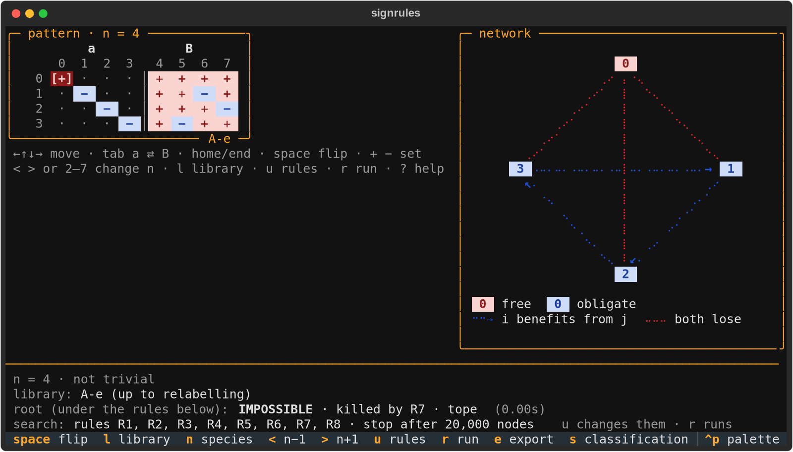

# signrules

[](https://github.com/gescholt/signrules/actions/workflows/ci.yml)
[](https://doi.org/10.5281/zenodo.24214426)

`signrules` proves Lotka–Volterra sign patterns **impossible**. Every proof comes with a machine certificate,
and an independent checker replays it.

A Lotka–Volterra community `ẋ = diag(x)(a − Bx)` is described qualitatively by its *sign pattern*: the signs
of the growth rates `a` and of the interaction matrix `B`. The pattern is *possible* if some magnitudes with
these signs have a positive equilibrium that is locally asymptotically stable, and *impossible* otherwise.

## Install

```bash
uv tool install ecological_sign_rules     # the signrules command; Python 3.10 or later
```

The package is `ecological_sign_rules` on [PyPI](https://pypi.org/project/ecological_sign_rules/) and imports
as `signrules`. Without installing: `uvx --from ecological_sign_rules signrules`. In a project:
`uv add ecological_sign_rules`. [uv](https://docs.astral.sh/uv/) itself installs with
`curl -LsSf https://astral.sh/uv/install.sh | sh` or `brew install uv`.

## First run

```bash
signrules
```



This opens an app in the terminal:

1. **Pick a pattern** in the library (↑ ↓, enter), or start from an empty matrix.
2. **Edit it**: the arrow keys move over the sign matrix `[diag(a) | B]`, space flips a sign, `<` and `>`
   remove or add a species.
3. **Press `r`** to search. A dashboard shows the search live; the verdict comes at the end, with the
   certificate under it for an impossible pattern.

`?` lists every key; Esc goes back, `q` quits.

The same from the command line:

```bash
signrules run --preset A-e                         # a four-species pattern proved impossible: verdict and certificate
signrules run --a +--- --B "+-++/-+++/+++-/++-+"   # your own pattern: the signs of a, then the rows of B
signrules verify                                   # check the classification on four, five and six species
```

## Verdicts and terms

A search ends in one of three verdicts:

* **Impossible**: no magnitudes with these signs have a stable positive equilibrium. The certificate printed
  with the verdict is the proof, and the independent checker has replayed it.
* **Not decided by the rules**: some sign tables survive every rule. The pattern may be possible; the rules
  cannot tell.
* **Undecided**: the search stopped at its node limit (20,000 by default; `--max-nodes 0` lifts it).

The words used below:

* **sign table**: a sign for every minor of `B` (equivalently, every Plücker coordinate of `[diag(a) | B]`).
* **killed**: every sign table is ruled out, so the pattern is impossible. **Killed at the root**: ruled out
  by propagation alone, before any branching; the certificate is then a short list of steps.
* **completion**: a full sign table that no rule rules out.
* **certificate**: the steps from the pattern to a contradiction, each naming the identity or inequality
  that forces it.
* **trivial**: some obligate species has only harmful interactions, so no positive equilibrium exists at all.
* **deletion lemma**: deleting a species from an impossible pattern leaves an impossible or trivial one. So
  every impossible pattern on n species extends one on n − 1 species, and the *extension screen* lists the
  candidates.
* **minimal impossible**: impossible, with every one-species deletion impossible or trivial.

## Commands

| command | what it does |
|---|---|
| `run` | complete one pattern with a live dashboard; prints the verdict and, for a kill, the certificate |
| `tree` | complete one pattern and write an interactive HTML viewer of the search tree |
| `replay` | kill one pattern at the root and check its certificate with the independent replayer |
| `edit` | the full-screen app (also plain `signrules`): library, matrix editor, network, rules, search, verdict |
| `presets` | list the named patterns (the eleven n = 4 patterns, the n = 5, 6 presets) with short ids |
| `screen` | list the candidates for impossible n-species patterns (deletion lemma) and run the rules on each |
| `verify` | check the classification on four, five and six species: every pattern killed or certified possible |

`signrules <command> --help` gives the options and examples. Signs are written `+-...`, `+,-,...` or
`1,-1,...`; the rows of `B` are separated by `/`, and its diagonal is `+`. A preset is named by its short id
(`signrules presets`) or any unambiguous prefix of its name. `--rules` takes `all` (the default), `annals`
(the rules of the first paper below) or a list such as `R1,R2,R7`. `--plain`, or output to a file, prints the
verdict only. `--cert DIR` draws the certificate (needs Graphviz). `python -m signrules` is the same command.

## What it proves

* **Four species**: each of the 3044 patterns up to relabelling is decided. 715 are killed at the root (11
  of them non-trivial: the eleven candidates of Meng et al.); each of the other 2329 has a *certificate of
  possibility*, a rational matrix whose equilibrium is checked stable in exact arithmetic.
* **Five and six species**: the deletion lemma, applied to the impossible patterns on one species fewer,
  leaves 83 candidates at n = 5 and 143 at n = 6, and every one is decided: 24 and 41 are killed at the root,
  the other 59 and 102 have certificates of possibility. So exactly 24 five-species and 41 six-species
  patterns are impossible, the minimal impossible patterns.

`signrules verify` checks all of this from the data shipped with the package, in about 15 seconds: it
rebuilds the candidate lists, redoes and replays every kill, and checks every certificate.
* **Any number of species**: two benefactor-permutation families are impossible (`scripts/families.py`).

## Use from Python

```python
from signrules import Ecology, complete

eco = Ecology.parse("+---", "+-++/-+++/+++-/++-+")   # the strings of the command line; lists of ±1 work too
print(eco)                                           # the sign matrix [diag(a) | B]
result = complete(eco)
print(result.verdict, result.summary())              # impossible  impossible at the root (R8 real eigenvalue ...)
```

* For a kill, `replay_kill(eco, result)` re-derives every step with the independent checker, and
  `write_certificate(eco, result, "cert")` draws the certificate (needs Graphviz).
* For an open pattern, `result.completions` holds the surviving sign tables, and `eco.minor_signs(table)`
  names one as `{minor: sign}`.
* `signrules.patterns` has the named patterns: `ELEVEN` (four species), `PATTERNS` (five and six),
  `parity_pattern`, `random_pattern`.
* `signrules.data` has the classification: `census(4)`, and `screen_records(n)`, `root_kills(n)` and
  `possible(n)` for n = 5, 6. `signrules.possible.check_witness` checks a certificate of possibility.

The docstring of `complete` lists its options.

## How it works

The matrix `[diag(a) | B]` is a point of the Grassmannian `Gr(n, 2n)`, and every Plücker coordinate is a minor
of `B` up to a known sign. Feasibility and stability become constraints on one set of sign variables. The
search propagates the 3-term Grassmann–Plücker relations and the rules below to a fixed point, then branches
on an open sign. A contradiction kills the branch, and the steps that led to it form the certificate. The
tests check that the rules never reject a genuine feasible, stable system.


| rule | what it says | source |
|---|---|---|
| `R1` | stability: `det B > 0` and positive coefficients of the characteristic polynomial | [1] |
| `R2n` | Cramer's rule on the full system | [1] |
| `R2` | Cramer's rule on every subsystem | [2] |
| `R3` | balanced patterns: the principal-minor signs of an M-matrix | [2], Theorems 3.1–3.2 |
| `R5` | Laplace expansion of every minor along a row or a column | [2] |
| `R7` | tope rule, the oriented-matroid Farkas lemma; it contains `R2` | new |
| `R8` | a real positive eigenvalue for benefactor-permutation patterns | new |

The two new rules will appear in a paper in preparation. Two rules from [2], `R4` and `R6`, are subsumed by
these and not run. [docs/SIGNRULES.md](https://github.com/gescholt/signrules/blob/main/docs/SIGNRULES.md)
gives the full account: the dictionary between minors and Plücker coordinates, each rule with its proof,
certificates and replay, the search, and the screens.

## Conventions

Species are numbered from 0 here and from 1 in the papers. `b_ii > 0`. `B[i, j] < 0`: species `j` benefits
species `i` (food, a mutualist); `B[i, j] > 0`: `i` loses to `j` (competition, predation). `a_i > 0`: species
`i` grows alone (free); `a_i < 0`: it does not (obligate). In `[diag(a) | B]` the columns `0..n-1` carry
`diag(a)` and `n..2n-1` carry `B`, so `p_0367` is the Plücker coordinate on columns 0, 3, 6, 7. In the
network drawings, a dashed arrow i → j means that i benefits from j, a red line joins two species that each
lose to the other, and free species are pink, obligate ones blue.

## Reproducing the papers

The package does not need the `scripts/` folder; the scripts reproduce the numbers of the papers from a clone
of the repository. Their records are in `data/`.

| result | command |
|---|---|
| the eleven four-species kills; with `--rules R1,R2n`, the completion counts of [1] (S-d, S-e, A-a, A-c: 64, 64, 1996, 1528) | `uv run python scripts/impossible_eleven.py` |
| the extension screens: 83 candidates at n = 5, 143 at n = 6 | `signrules screen 5 --out n5.jsonl`, `signrules screen 6 --out n6.jsonl` |
| every root kill replays, and flipping any single step makes the replay fail | `uv run python scripts/replay_certificates.py 6 --tamper` (and 4, 5) |
| the exhaustive five-species screen of all 248,436 non-trivial patterns up to relabelling: 21 kills under R1–R6, three more by R8 | `uv run python scripts/screen_all.py --rules R1,R2,R3,R4,R5,R6` (100 CPU-minutes) |
| the benefactor-permutation families | `uv run python scripts/families.py` |
| what each rule adds on the minimal impossible patterns | `uv run python scripts/rule_ladder.py 4 5 6 --out ladder.jsonl` |
| R4 and R6 are subsumed by the other rules | `uv run python scripts/rule_ablation.py 3 4 --census`, `uv run python scripts/r4_subsumption.py 3 4 --rules R1,R7 --others` |

## Development

```bash
git clone https://github.com/gescholt/signrules.git && cd signrules
uv sync --all-extras             # the environment from uv.lock, with the extras and pytest
uv run pytest -q                 # about a minute
```

The extras are `live` (questionary: menus for `signrules run` without a pattern) and `html` (plotly, for
`save_search_tree_html`). Graphviz (`apt install graphviz`, `brew install graphviz`) is needed only to draw
certificates and trees.

## Papers

The package extends the sign-completion algorithm of [1] with the arguments of [2], read as propagation rules:

* [1] T. Ö. Çelik, P. A. Haas, G. Scholten, K. Wang, G. Zucal, *Strata of ecological coexistence via
  Grassmannians*, Ann. Comb. (2026), [doi:10.1007/s00026-026-00837-7](https://doi.org/10.1007/s00026-026-00837-7),
  [arXiv:2509.00165](https://arxiv.org/abs/2509.00165).
* [2] T. Ö. Çelik, V. A. Isoldi, I. Portakal, G. Zucal, *Stable coexistence in ecologies and games* (2026),
  [arXiv:2609.09286](https://arxiv.org/abs/2609.09286).

The four-species patterns come from Y. Meng, S. Horvát, C. D. Modes, P. A. Haas, *Impossible ecologies:
interaction networks and stability of coexistence in ecological communities*, Cell Systems 16 (2025) 101297,
[doi:10.1016/j.cels.2025.101297](https://doi.org/10.1016/j.cels.2025.101297).

## Citation and licence

Every release is archived on Zenodo: [doi:10.5281/zenodo.24214426](https://doi.org/10.5281/zenodo.24214426)
(all versions). To cite, see [CITATION.cff](https://github.com/gescholt/signrules/blob/main/CITATION.cff).
Changes are listed in [CHANGELOG.md](https://github.com/gescholt/signrules/blob/main/CHANGELOG.md). MIT
licence. Questions and bug reports: [open an issue](https://github.com/gescholt/signrules/issues).
