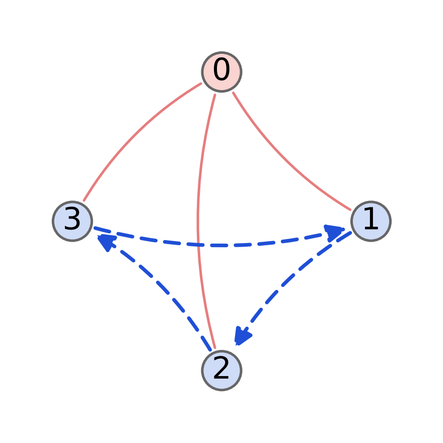

# signrules

Sign completion on the ecological Grassmannian: a Python package that proves Lotka–Volterra sign
patterns **impossible**, with a machine certificate for every proof and an independent checker that
replays it.

## Try it

```bash
git clone git@github.com:gescholt/signrules.git && cd signrules && pip install -e ".[all]"
signrules                                          # the app: pick a pattern in the library, press r
signrules run --preset A-e                         # a four-species pattern proved impossible: verdict + certificate
signrules run --a +--- --B "+-++/-+++/+++-/++-+"   # a pattern of your own: signs of a, then the rows of B
```

Each run ends in one of three verdicts. **Impossible**: no magnitudes with these signs have a stable
positive equilibrium; the certificate printed below the verdict is the proof, and an independent checker
replays it. **Not decided by the rules**: sign tables survive every rule, so the pattern may have a
realisation (the rules cannot say). **Undecided**: the search stopped at its limit, 20,000 nodes by
default (`--max-nodes 0` lifts it; Ctrl-C stops early and keeps what was found).

## Run

Type `signrules`. A full-screen app opens on the pattern library; everything else is a key, listed in the
footer:

| key | what it does |
|---|---|
| ↑↓ enter (in the library) | preview a pattern's matrix and network, load it; the `tree_*` patterns come first |
| ←↑↓→, tab, space, click | move over the sign matrix `[diag(a) | B]`, jump between a and B, flip a sign |
| `<` `>` or `2`–`7` | one species less / more, or n directly |
| `u` | the rules (checkboxes; `a` all, `c` annals = R1,R2n) and the node limit |
| `r` | run the search: live dashboard, then the verdict (certificate and replay for a root kill); there `h` writes the tree viewer, `c` the certificate drawing, `x` stops, esc comes back |
| `e` | export the network as png, pdf and the article's `\econet` call |
| `s` | the classification: what the rules decide for n = 4, 5, 6 |
| `?`, `q` | help, quit |

The status line under the matrix follows every edit: trivial or not, the library pattern it equals up to
relabelling, the root verdict under the chosen rules. The same app opens with a pattern through
`signrules edit --preset A-e`.

Without the app, for scripts and logs, the same steps are subcommands (`signrules --help`,
`signrules <command> --help`; `python -m signrules` is the same):

| command | what it does |
|---|---|
| `run` | complete one pattern with a live dashboard; prints the verdict and, for a kill, the certificate |
| `tree` | complete one pattern and write an interactive HTML viewer of the search tree |
| `replay` | kill one pattern at the root and check its certificate with the independent replayer |
| `edit` | the full-screen app (also plain `signrules`): library, matrix editor, network, rules, search, verdict |
| `presets` | list the named patterns (the eleven n = 4 patterns, the n = 5, 6 presets) with short ids |
| `screen` | list the candidates for impossible n-species patterns (deletion lemma) and run the rules on each |

```bash
signrules presets                                  # the named patterns, one line each (--long for the notes)
signrules run --preset tree_S-d                    # a search tree to watch: 64 completions, 4 contradictions
signrules run --preset S-d --rules annals          # the Annals paper's algorithm (R1,R2n): 64 completions
signrules run --random 5 --html random.html        # a random pattern, then the interactive tree viewer
signrules replay --preset A-d --cert out/          # root kill, independent replay, certificate as png/pdf/dot
```

Signs are written `+-...`, `+,-,...` or `1,-1,...`; the rows of `B` are separated by `/` and its diagonal
is `+`. A preset is named by its short id or any unambiguous prefix of its name. The `tree_*` presets are
patterns the root does not decide, so the search grows a tree with completions and contradictions; the
other four-species presets die at the root under all rules, and the five- and six-species ones grow trees
too large to finish (the node limit ends them). `--rules` takes `all` (the default), `annals` (R1,R2n) or a
comma list of rule names. Mistakes (an unknown preset, a rule name, a wrong size of `B`) are reported in
one line, and `signrules <command> --help-all` lists the options kept for the ablations of the paper.

During a search the terminal shows a live dashboard: the share of the tree already swept, the signs forced
and the branches closed by each rule, the current path, completions and contradictions by depth. At the end
comes the verdict:

```
╭─ verdict ────────────────────────────────────────────────────────────────────────────────────╮
│ IMPOSSIBLE  ·  killed at the root by R7 · tope                                               │
│ A-e competitor + 3-cycle (Thm 3.5) · n = 4, sign a = (+,−,−,−) · rules R1–R8                 │
│ No magnitudes with these signs have a stable positive equilibrium: the certificate below is  │
│ the proof, replayed by an independent checker.                                               │
│                                                                                              │
│   #  sign        minor                      rule                     uses                    │
│   1  p_4567 > 0  det B > 0                  R1 · stability           —                       │
│   2  p_0367 < 0  det B_{1,2},{2,3} > 0      R7 · tope                4 entries               │
│    …                                                                                         │
│  14  p_0256 > 0  det B_{1,3},{1,2} > 0      GP · 3-term relation     #12 #13 + 3 entries     │
│      ⊥           contradiction              R7 · tope                #14 + 4 entries         │
│                                                                                              │
│ replay OK  14 steps and the contradiction re-derived by the independent checker              │
╰──────────────────────────────────────────────────────────────────────────────────────────────╯
```

`--plain`, or output to a file or pipe, prints only the verdict. The tree viewer (`--html`, or
`signrules tree`) is one self-contained HTML file: click a node to see the signs it forced with their
rules, what the known signs say about stability and feasibility, and every minor of `B`; at a
contradiction it names the violated rule and its premises.



*The network of A-e as `e` exports it: pink nodes are free (a_i > 0), blue nodes obligate; a blue dashed
arrow i → j means i benefits from j (b_ij < 0); a thin red line marks a pair that loses both ways; one-way
losses are not drawn. `network.econet_tex` gives `\econet[4]{p,m,m,m}{1/2/b,2/3/b,3/1/b,0/1/c,0/2/c,0/3/c}`.*

## Use from Python

```python
from signrules import Ecology, complete

eco = Ecology.parse("+---", "+-++/-+++/+++-/++-+")   # the strings of the command line; lists of ±1 work too
print(eco)                                           # the sign matrix [diag(a) | B]
result = complete(eco)
print(result.verdict, result.summary())              # impossible  impossible at the root (R8 real eigenvalue ...)
```

For a kill, `result.root_log` holds every sign a rule forced at the root with the rule and its premises;
`certificate_steps(eco, result)` (from `signrules.certificate`) is the backward slice of that log, the
certificate; `replay_kill(eco, result)` re-derives every step with the independent checker;
`write_certificate(eco, result, "cert")` draws it as cert.png / .pdf / .dot (needs Graphviz). For an open
pattern, `result.completions` are the surviving sign tables and `eco.minor_signs(table)` reads one as
`{minor name: sign}`:

```python
from signrules import ELEVEN, search_tree_text, save_search_tree_png

a, B = ELEVEN["S-d {0,1}|{2,3}, {2,3} obligate, a01=(+,-)"]
eco = Ecology(a, B)
result = complete(eco, use=("R1", "R2n"), record_tree=True)   # the Annals paper's algorithm
print(result.verdict, result.summary())                       # open  64 completions, 131 nodes, 4 pruned
print(eco.minor_signs(result.completions[0]))                 # {'det B_{0},{1}': 1, ...}
print(search_tree_text(eco, result, max_depth=3))
save_search_tree_png(eco, result, "tree.png")
```

`complete(eco, use=..., max_nodes=..., max_completions=..., record_tree=..., progress=...)` are the
keywords a user sets; the docstring lists the others under "for the ablations". Patterns to start from
are in `signrules.patterns`: `ELEVEN` (the eleven four-species patterns of Meng et al., proved impossible
in CIPZ), `parity_pattern` (the benefactor-permutation family of R8), `PATTERNS` (five- and six-species
presets), `random_pattern`, `canonical_classes(n)`. The data of the classifications is in
`signrules.data`: `root_kills(5)` returns the 24 minimal impossible five-species patterns,
`screen_records(6)` the 143 six-species candidates with their verdicts (the `open` rows are certified
possible only in `feasible_ecologies`).

## Install

Not on PyPI; Python 3.10 or later.

```bash
pip install -e .                 # the package and the signrules command: numpy, matplotlib, networkx, rich
pip install -e ".[all,dev]"      # + questionary, textual (the app and the menus), plotly (HTML trees), pytest
pytest -q                        # about a minute
```

Graphviz (`dot`; `apt install graphviz` or `brew install graphviz`) is needed only for the Graphviz
drawings: certificates, completions and `write_search_tree`.

## Conventions

Species are 0-based. `b_ii > 0`. `B[i, j] < 0`: species `j` benefits species `i` (food, a mutualist);
`B[i, j] > 0`: `i` loses to `j` (competition, predation). `a_i > 0`: species `i` grows when alone (free);
`a_i < 0`: it does not (obligate). A pattern is *trivial* when some obligate species has only harmful
interactions (it cannot have a positive equilibrium at all). In the matrix `[diag(a) | B]` the columns
`0..n-1` carry `diag(a)` and `n..2n-1` carry `B`, which is how the app and the certificates number them.
The dictionary between the minors of `B` and the Plücker coordinates, and the representation of a sign
table, are in [docs/SIGNRULES.md](docs/SIGNRULES.md) §1 and §3.

## What it computes

A Lotka–Volterra community `ẋ = diag(x)(a − Bx)` is described qualitatively by the signs of the growth
rates `a` and of the interaction matrix `B`. The pattern is *possible* if some magnitudes with these signs
have a positive equilibrium that is locally asymptotically stable, and *impossible* otherwise. Encoding
`[diag(a) | B]` as a point of the Grassmannian `Gr(n, 2n)`, every Plücker coordinate is a minor of `B` up to
a known sign, so the feasibility, stability, M-matrix and Schur-complement arguments of the two papers below
all become constraints on one set of sign variables, the same variables on which the oriented-matroid
(Grassmann–Plücker) propagation acts. The package runs

* **chirotope propagation**, the 3-term Grassmann–Plücker relations (complete for uniform chirotopes), and
* the **sign rules R1–R8**: stability (`det B > 0`, positive coefficients of the characteristic polynomial),
  Cramer's rule on every subsystem, M-matrix minor signs of balanced patterns, Laplace expansions, the
  oriented-matroid Farkas lemma (tope / circuit orthogonality, complete for feasibility), and the real
  eigenvalue of benefactor-permutation patterns,

to a fixed point at every node of a depth-first sign-completion search. A pattern that is *killed* is a
proved impossible ecology, and the backward slice of the log from the contradiction is its certificate.
The rules are checked never to reject a genuine feasible, stable system. The rule names are `R1`
stability, `R2` subsystem Cramer (`R2n`: full system only), `R3` balanced patterns, `R5` Laplace, `R7`
tope (subsumes `R2`), `R8` real eigenvalue, and the retired `R4` Z-blocks and `R6` Schur blocks, which the
other rules subsume (`docs/SIGNRULES.md`, "R4 and R6 are subsumed"); `complete()` idles them by default.

**New since the Annals paper's Maple algorithm:** [docs/CHANGES.md](docs/CHANGES.md) (one page, also as
[PDF](docs/changes.pdf)): the rules added, the trust machinery, the measured optimisations, what it decides now.

## Papers

The package extends the sign-completion algorithm (the Maple implementation accompanying the paper, "the
Annals paper's algorithm", `--rules annals`) of

* T. Ö. Çelik, P. A. Haas, G. Scholten, K. Wang, G. Zucal, *Strata of ecological coexistence via
  Grassmannians*, Ann. Comb. (2026), [doi:10.1007/s00026-026-00837-7](https://doi.org/10.1007/s00026-026-00837-7),
  [arXiv:2509.00165](https://arxiv.org/abs/2509.00165) ("the Annals paper"),

with the arguments of

* T. Ö. Çelik, V. A. Isoldi, I. Portakal, G. Zucal, *Stable coexistence in ecologies and games* (2026),
  [arXiv:2609.09286](https://arxiv.org/abs/2609.09286) ("CIPZ"),

read as propagation rules. The patterns both papers start from are those of

* Y. Meng, S. Horvát, C. D. Modes, P. A. Haas, *Impossible ecologies: interaction networks and stability
  of coexistence in ecological communities*, Cell Systems 16 (2025) 101297,
  [doi:10.1016/j.cels.2025.101297](https://doi.org/10.1016/j.cels.2025.101297).

The converse tool, certificates that a pattern *is* possible (tropical witnesses), lives in the companion
repository [`feasible_ecologies`](https://github.com/gescholt/feasible_ecologies) (private; ask for access),
which depends on this package. Nothing here needs it: it is only where the witnesses, the LaTeX statements
of the rules (`docs/tex/sign_rules.pdf`) and the article are, which the documents below point to.

## Results and how to reproduce them

The scripts under `scripts/` are not needed to run the method: they reproduce the numbers of the papers.

| case | result | command |
|---|---|---|
| **n = 4** | all eleven candidate impossible ecologies of Meng et al. are killed at the root; with `--rules annals` the search reproduces the completion counts of the Annals paper's algorithm quoted in CIPZ (S-d, S-e, A-a, A-c: 64, 64, 1996, 1528) | `python scripts/impossible_eleven.py [--rules R1,R2n]` |
| **n = 5** | exhaustive root screen of all 248,436 non-trivial ecologies up to relabelling: 21 kills under R1–R6 (10 of them new), 24 with R8 | `python scripts/screen_all.py --rules R1,R2,R3,R4,R5,R6` (100 CPU-minutes); `signrules/data/n5/killed_patterns.json` |
| **n = 5, 6** | extension screens by the deletion lemma: **83** candidates at n = 5, **24** killed; **143** at n = 6, **41** killed; the rest are certified possible in `feasible_ecologies`, so these are exactly the minimal impossible patterns | `signrules screen 5 --out out/n5.jsonl`, `signrules screen 6 --out out/n6.jsonl`; the shipped lists are `signrules/data/n{5,6}/extension_screen.jsonl` |
| **all n** | benefactor-permutation families: every species obligate with a single benefactor is impossible for any benefactor permutation; with free species benefiting from everyone, impossible for any non-trivial permutation | `python scripts/families.py` |
| **certificates** | the 11 + 24 + 41 root kills replay in the independent checker; flipping any single step makes the replay fail | `for n in 4 5 6; do python scripts/replay_certificates.py $n --tamper; done` |
| **rule ladder** | what each rule buys on the minimal impossible patterns | `python scripts/rule_ladder.py 4 5 6 --out out/ladder.jsonl --tex out/ladder.tex` |
| **ablations** | R4 and R6 never fire under the other rules; R4 subsumed up to one branching, exhaustively per block configuration | `python scripts/rule_ablation.py 3 4 --census`, `python scripts/r4_subsumption.py 3 4 --rules R1,R7 --others` |

Without `--out`, `signrules screen` and `rule_ladder.py` overwrite the shipped data files.
[docs/SIGNRULES.md](docs/SIGNRULES.md) is the full account: the Plücker/minor dictionary, each rule and the
theorem it encodes, certificates and their replay, the search, soundness checks, the screens and the families.

## Layout

```
signrules/
  plucker_index.py, chirotope.py     minors of B <-> Plücker coordinates; 3-term Grassmann–Plücker propagation
  rules.py, engine.py, search.py     rules R1–R8 (Ecology, Conflict); trigger-driven fixpoint; complete()
  certificate.py, replay.py          derivation DAG of a kill or completion; independent replay of a certificate
  symmetry.py                        the pattern's relabelling stabilizer, used inside the search
  labels.py, style.py, gvrender.py, treeplot.py, treeview.py   the drawings and the HTML tree viewer
  cli.py, report.py, livesearch.py   the signrules command, the verdict, the live dashboard
  editor.py, network.py              the app (textual) and the interaction network as the article's \econet
  screen.py, patterns.py, data/      extension screen; ELEVEN, PATTERNS, parsers; candidate lists and kills
scripts/              reproduce the numbers of the table above
tests/                conventions, soundness against random feasible-stable systems, golden search trees, replay
docs/                 SIGNRULES.md, CHANGES.md, figures (with their generators), rule_ladder_table.tex
.github/workflows/    pytest on Python 3.10 and 3.13
```

## Licence and citation

MIT. Please cite the Annals paper and CIPZ ([CITATION.cff](CITATION.cff)).
