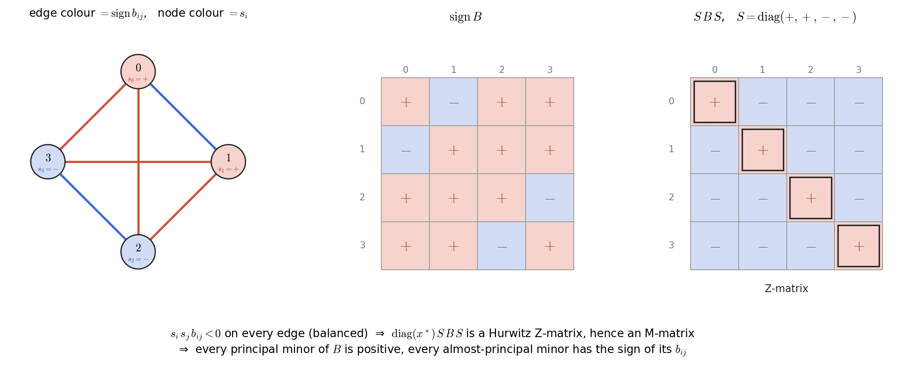
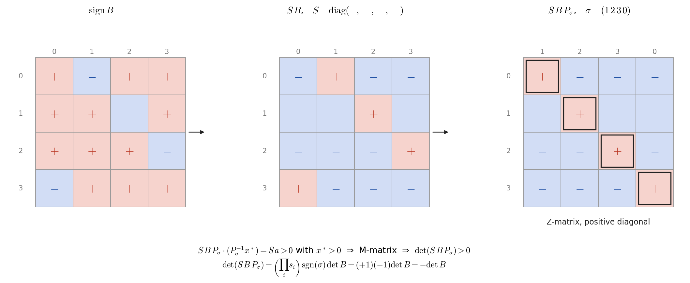
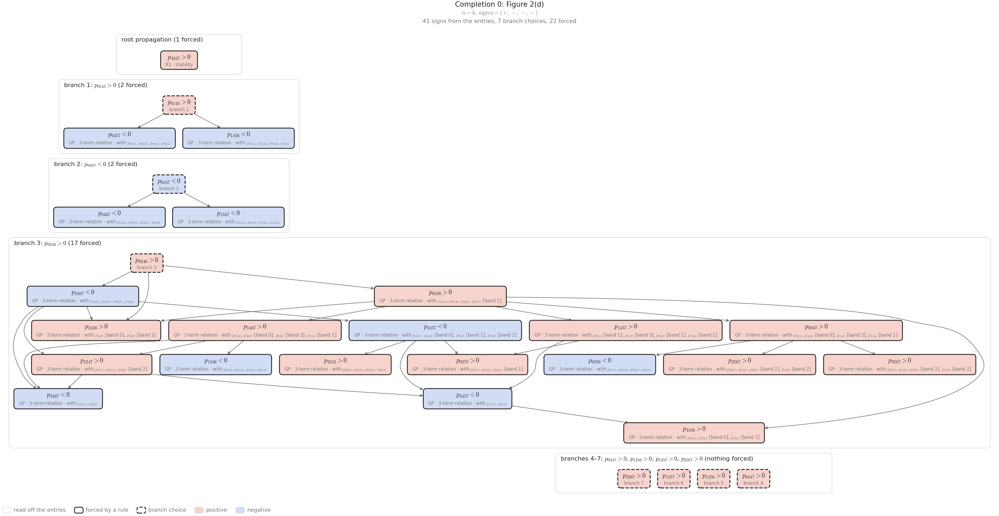

# Sign rules on the ecological Grassmannian (`signrules`)

This package combines the oriented-matroid sign completion of *Strata of Ecological
Coexistence via Grassmannians* (Çelik, Haas, Scholten, Wang, Zucal, Ann. Comb. 2026) with the
Z-/M-matrix and Schur-complement arguments of *Stable Coexistence in Ecologies and Games*
(Çelik, Isoldi, Portakal, Zucal, arXiv:2609.09286). It implements the refinement suggested at the
end of Section 3 of the latter: supplement the Grassmann–Plücker, feasibility and weak-stability
constraints with determinant and minor-sign constraints coming from Schur complements.

Citations below: Theorem, Lemma and Figure numbers 2.x–3.x refer to Çelik–Isoldi–Portakal–Zucal
(arXiv:2609.09286, "CIPZ" for short); "the Annals paper" is Çelik–Haas–Scholten–Wang–Zucal, Ann. Comb. 2026
(arXiv:2509.00165), whose Maple implementation is "the Maple algorithm"; Meng et al. is Y. Meng, S. Horvát,
C. D. Modes, P. A. Haas, *Impossible ecologies*, Cell Systems 16 (2025) 101297. A LaTeX version of the rules
with precise statements and soundness proofs is in the repository
[feasible_ecologies](https://github.com/gescholt/feasible_ecologies) (`docs/tex/sign_rules.pdf` and the article there).

Everything below is at the level of signs. A pattern that the rules *kill* is a proved impossible
ecology (the rules are sound, see §5). A pattern that survives is merely not decided by sign
propagation. The converse tool, a constructive certificate that a surviving pattern *is* possible, is the
tropical witness of the repository `feasible_ecologies` (`src/tropical` there): an integer matrix of orders
of magnitude whose one-parameter family of communities is feasible and stable for all small ε, found by an
integer program and verified exactly over Q. For n = 3 the two tools together decide every pattern (178
killed, 334 witnessed); for n ≤ 6 the rules, the witnesses and the deletion lemma (§6) decide every pattern.

*One run of `complete(Ecology(a, B))` (`docs/figures/make_diagrams.py`).*

**Reading the figures.** Every drawing in this document uses one vocabulary and one palette
(`signrules/labels.py`, `style.py`). A sign is a Plücker coordinate $p_S$ of
$[\operatorname{diag}(\mathbf a)\,|\,\mathbf B]\in\mathrm{Gr}(n,2n)$, written $p_{0257}>0$
(the minor of $\mathbf B$ behind it appears only inside the rule that is stated in terms of it).
Red means positive and blue negative, everywhere: entries of $\mathbf B$ (competition / mutualism),
coordinates, and the sign chosen on a branch of a search tree. The border of a coordinate says where
its sign came from — thin grey: read off the entries; black: forced by a rule; dashed black: a
branch choice — and a contradiction is a black $\bot$. Each rule has a hue of its own (the title
of its box in a certificate, its box in the overview below, the $\bot$ leaves it closes in a search
tree); nothing else is coloured. All labels are generated from the run, so the same code draws the
figures for any other pattern. `docs/figures/README.md` lists the conventions.

## 1. The dictionary: minors of B are Plücker coordinates

Write $M = [\operatorname{diag}(\mathbf a)\,|\,\mathbf B] \in \mathbb R^{n\times 2n}$, columns
$0,\dots,n-1$ for $\operatorname{diag}(\mathbf a)$ and $n,\dots,2n-1$ for $\mathbf B$ (0-based).
A basis $S \subset \{0,\dots,2n-1\}$ splits as $S = T_a \cup (n + Q)$; put $P = [n]\setminus T_a$.
Laplace expansion along the $\operatorname{diag}(\mathbf a)$ columns gives

$$p_S \;=\; \varepsilon(S)\,\Big(\prod_{j\in T_a} a_j\Big)\,\det \mathbf B_{P,Q},
\qquad \varepsilon(S) = (-1)^{\sum_{j\in T_a} j \;-\; \binom{|T_a|}{2}} .$$

So the $\binom{2n}{n}$ Plücker coordinates are exactly the minors of $\mathbf B$ with
$|P| = |Q|$ (all sizes, including the empty minor $p_{[n]} = \prod a_j$ and $\det\mathbf B$),
each with a sign that is known once the signs of $\mathbf a$ are fixed. In particular:

| object of the proofs | Plücker coordinate |
|---|---|
| principal minor $\det\mathbf B_{II}$ | $p_{[I^c,\,n+I]}$ (eq. (20) of the Annals paper) |
| Schur complement entry $(\mathbf B/\mathbf B_{PP})_{ij}$ | $\det\mathbf B_{(P,i),(P,j)} / \det\mathbf B_{PP}$ |
| minor of a Schur complement $\det(\mathbf B/\mathbf B_{PP})_{I,J}$ | $\det\mathbf B_{(P,I),(P,J)}/\det\mathbf B_{PP}$ (quotient formula) |
| cofactor $(\operatorname{adj}\mathbf B)_{ij}$ | $\pm\det\mathbf B_{[n]\setminus j,\,[n]\setminus i}$ |
| Cramer numerator $x_i^\star \det\mathbf B$ | $\sum_j \pm\, a_j \det\mathbf B_{[n]\setminus j,[n]\setminus i}$ (the feasibility inequality (17)) |

`plucker_index.py` implements this translation; `PluckerIndex.check_conventions()` verifies it
numerically, and `tests` checks it for $n \le 4$. Note that row/column order matters for
the sign: the quotient formula and the "Schur complement of an M-matrix is an M-matrix" statement
refer to the order $(P, i)$, and the code converts to sorted order with `merge_sign`.

The initial table of `Ecology.initial_table()` is the sign of every minor whose permutation
expansion has monomials of a single sign. For $n=4$ this fixes 38–41 of the 70
coordinates; the partial assignment $\chi(\sigma)$ of the Annals paper is the subset of size
$n^2+1$.

## 2. Chirotope propagation (`chirotope.py`)

For every $(n-2)$-set $C$ and $a<b<c<d$ outside $C$,
$p_{abC}\,p_{cdC} - p_{acC}\,p_{bdC} + p_{adC}\,p_{bcC} = 0$. With all coordinates nonzero the
three terms cannot share a sign, so two agreeing known terms force the third. This unit propagation
is run to a fixed point at every node. For uniform chirotopes the 3-term relations imply the full
chirotope axioms (Björner–Las Vergnas–Sturmfels–White–Ziegler, Thm 3.6.2), so a complete table
passing the 3-term test is the chirotope of an oriented matroid, though not necessarily a
*realizable* one; sign propagation cannot detect realizability. What the rules add is mainly
inequality information (Perron–Frobenius, positivity of $\mathbf x^\star$).

## 3. The rules (`rules.py`)

*Hypotheses (left) → rules (middle) → the shared sign table (right). Grey: already in the Annals
paper's algorithm; yellow: new; dotted: R4 and R6, retired because the other rules subsume them (below).
Source `docs/figures/make_diagrams.py`.*

Standing hypotheses: $\mathbf x^\star = \mathbf B^{-1}\mathbf a > 0$, $J = -\operatorname{diag}
(\mathbf x^\star)\mathbf B$ Hurwitz, no vanishing Plücker coordinate. Throughout,
$\mathbf w_J := \mathbf a_J - \mathbf B_{J,J^c}\mathbf x^\star_{J^c}$ is the right-hand side of the
rows $J$ of $\mathbf B\mathbf x^\star = \mathbf a$ after moving the other species across; its sign
is known whenever $a_k$ and all $-b_{kr}$, $r\notin J$, agree.

**R1 — stability.** $\det\mathbf B > 0$ (coefficient $c_0$), and for each size $k$ the coefficient
$c_{n-k} = \sum_{|I|=k} x^\star_I \det\mathbf B_{II}$ is positive, so some principal $k$-minor is
positive (weak stability in the sense of the Annals paper). This is exactly the stability content
of the Maple algorithm.

**R2 — subsystem Cramer rule.** $\mathbf B_{JJ}\mathbf x^\star_J = \mathbf w_J$, hence
$x_j^\star\det\mathbf B_{JJ} = \sum_{k\in J}\operatorname{cof}_{kj}(\mathbf B_{JJ})\,w_k$ must have
the sign of $\det\mathbf B_{JJ}$. $J=[n]$ is plain feasibility; smaller $J$ is the mechanism of
Theorem 3.2 ($\mathbf B_{JJ}\mathbf x_J < 0$ for the obligate group). `R2n` restricts to $J = [n]$
and reproduces the Maple algorithm.

**R3 — balanced patterns.** If the interaction graph is balanced (a signature
$\mathbf s\in\{\pm1\}^n$ with $s_is_jb_{ij}<0$ for $i\ne j$, e.g. two competing mutualistic groups),
$S\mathbf B S$ is a Z-matrix and $-SJS = \operatorname{diag}(\mathbf x^\star)S\mathbf B S$ is a
Z-matrix with eigenvalues in the open right half-plane, hence a nonsingular M-matrix. Therefore all
principal minors of $\mathbf B$ are positive and, since Schur complements of M-matrices are
M-matrices, every almost-principal minor $\det\mathbf B_{(I,i),(I,j)}$ has the sign of $b_{ij}$.
For $n=4$ this fixes 64 of the 70 Plücker signs. (Theorems 3.1, 3.2.) A side remark: for balanced
patterns weak stability already implies Hurwitz stability, because the eigenvalue of minimal real
part of a Z-matrix is real.

**R4 — Z-semipositivity on Schur blocks.** For disjoint $P, Q$, the block
$D = (\mathbf B/\mathbf B_{PP})_{QQ}$ satisfies $D\,\mathbf x^\star_Q = \mathbf A_Q$ with
$\mathbf A_Q = \mathbf w_Q - \mathbf B_{QP}\mathbf B_{PP}^{-1}\mathbf w_P$ (Cramer again: its
entries are signed sums of Plücker coordinates over $\det\mathbf B_{PP}$). If a row-sign twist $S$
and a column permutation $\sigma$ make $SDP_\sigma$ a Z-matrix with positive diagonal — each row of
$D$ has exactly one entry of one sign and the exceptional positions form a permutation — then:

* $S\mathbf A_Q > 0$: $SDP_\sigma$ is a nonsingular M-matrix (semipositivity), so all its principal
  minors are positive and all almost-principal minors negative;
* $S\mathbf A_Q < 0$: by Collatz–Wielandt $SDP_\sigma$ has a negative real eigenvalue, so it is
  not an M-matrix and *no* ordering of $Q$ has all leading principal minors positive (for a
  $2\times2$ block: its determinant is negative).

Minors of $D$ are minors of $\mathbf B$ divided by $\det\mathbf B_{PP}$, so these are Plücker
constraints. $P=\emptyset$, $Q=[n]$, $\sigma$ the prey map and $S=-I$ is Theorem 3.4; with the
first species kept aside it is Theorems 3.5–3.6; the $2\times2$ blocks of Lemmas 3.8–3.10 are the
not-M case. Under the full rule set R4 is idle (never forces a sign that R2, R3, R5, R7, R8 have not
set: "R4 and R6 are subsumed" below), and `complete()` no longer runs it by default.

**R5 — Laplace expansion** of every minor of $\mathbf B$ along every row and column.

**R6 — Schur blocks.** (`rule_schur`) The sign of a minor of $D$ when all permutation
monomials in its entries agree (this is the "$\det C = c_{11}c_{44}+c_{14}c_{41} > 0$" step of
Lemma 3.10), and the rows of $D\mathbf x_Q = \mathbf A_Q$ with $\mathbf x_Q > 0$ (the "$(C)_{21}$
is forced negative" step). Both parts are special cases of the 3-term relations and of R7 ("R4 and
R6 are subsumed" below); `complete()` no longer runs R6 by default.

**R7 — tope (oriented-matroid Farkas lemma).** Row $i$ of $\mathbf B\mathbf x=\mathbf a$ is
$\langle\mathbf b_i,\mathbf x\rangle=a_i$, so the sign vectors $(\operatorname{sign}\mathbf x,\operatorname{sign}\mathbf B\mathbf x)$
are exactly the covectors of the oriented matroid of $N=[I\,|\,\mathbf B^{\!\top}]$, whose chirotope is
$\chi_N(T\cup(n+Q))=\varepsilon(T)\,\operatorname{sign}\det\mathbf B_{Q,P}$, $P=[n]\setminus T$ — again minors of
$\mathbf B$. Feasibility says that $(+^n,\operatorname{sign}\mathbf a)$ is a tope, i.e. orthogonal to every
circuit. In the uniform case every $(n+1)$-subset $C=\{e_0<\dots<e_n\}$ is a circuit with
$C(e_k)=(-1)^k\chi_N(C\setminus e_k)$, and orthogonality means the $n+1$ products $T(e_k)C(e_k)$
are not all equal. This is the *complete* sign-level content of $\mathbf x^\star>0$ (Bland–Las Vergnas):
R2 is the special case of the circuits supported on one row subset, and on the $n=3$ census R7 is
strictly stronger on 38 of 512 patterns. It costs $\binom{2n}{n+1}$ checks (210 at $n=5$).

**R8 — real eigenvalue.** (`rule_real_eigenvalue`) If a twist $s$ and a permutation $\sigma\neq\mathrm{id}$
make $S\mathbf BP_\sigma$ a Z-matrix with $s\cdot\mathbf a>0$ (R4 on the whole matrix, M-matrix case),
or with $s_ia_i<0$ for exactly one species and $\sigma$ having an even number of cycles,
the pattern is impossible: the Jacobian has a positive real eigenvalue. With $X=\operatorname{diag}\mathbf x^\star$,
$D_t=S(\mathbf BX+tI)P_\sigma$ is a Z-matrix for every $t\ge0$ (the term $tSP_\sigma$ only adds $-t$
off the diagonal on the species $\sigma$ moves, where $s=-1$, and $+t$ on the diagonal at fixed points).
It is a nonsingular M-matrix at $t=0$, and $D_t\mathbf 1_N\le0$ for large $t$, where $\mathbf 1_N$ is the
indicator of the moved species. So its least real eigenvalue crosses $0$ at some $t_1>0$, where
$\mathbf BX+t_1I$ is singular, and $t_1$ is an eigenvalue of $-X\mathbf B$. This is a statement about
eigenvalues, not coefficients: R1 cannot see it.
With one wrong growth sign, $D_0$ is still a nonsingular M-matrix: its block off that species has
positive row sums, hence positive principal minors, and $\det D_0=(-1)^k\det\mathbf B\det X>0$ for
$k$ even under R1; so all leading principal minors are positive when the wrong species comes last
(case (d) of §7). This decides the last two five-species and five six-species patterns.

Each rule either raises `Conflict`, forces some signs (`set_minor`, logged with the rule name so a
kill comes with a certificate), or does nothing. `Ecology.apply_rules` iterates them to a fixed point
together with the chirotope propagation; `search.complete` branches on an unknown sign when
the fixed point is not complete.

`search.complete` computes that fixed point with `signrules/engine.py` by default. Each rule is
split into small monotone propagators (one per 3-term relation, signed sum of R1/R2/R5, circuit of
R7, Schur block of R4/R6), every coordinate knows the propagators that read it, and after a branch
choice only those touching changed coordinates run, in priority levels from the 3-term relations up
to the Z-blocks. Monotonicity makes the fixed point independent of the order, so verdicts and
completions are those of the full sweep (`engine="sweep"`), 5–9 times faster on the $n=4$ searches.
Sign tables are flat lists indexed by basis id (`UNKNOWN = 0`), and every propagator is compiled to ids
once per pattern; against the earlier dict-keyed tables this halves the time of the $n=5$ and $n=6$
extension screens (226 first-completion searches: 97 s → 51 s single-threaded, identical trees, nodes
and completions) and cuts the per-node cost of a seven-species search from about 10 ms to 5 ms.
Branching goes to the open coordinate read by the most propagators; on the 32 known $n=4,5$ kills
under `R1,R2n,R5,R6` that prunes about seven times fewer nodes than taking the first open sign.
Because cheap rules run first, the certificates differ: under all rules every root kill of the $n=4$
census has R2 or R7 as its last step and none uses R4 or R6 (`scripts/rule_usage.py`).

### The engine, and why R4 and R6 are idle

Under the full rule set the Schur-block rules are in fact idle: `complete(stats=True)` counts the
runs, forced signs and conflicts of every rule at the root and below it, and on the eleven $n=4$
patterns and all 226 patterns of the $n=5,6$ extension screens R4 and R6 run 112k and 97k times at
the root and 803k and 679k times below it without forcing a sign or raising a conflict
(`scripts/rule_ablation.py`, records in `signrules/data/rule_ablation/`; the same on 700 random patterns
with $n=3,4,5$). On the eleven, R6 alone forces 40 signs and R4 alone 25, and R2 and R5 leave some
of them to R6; it is R7 that makes R6 redundant (under `R1,R7,R6` R6 forces nothing) and R4 nearly
so. `complete(root_only=("R4", "R6"))` keeps their propagators registered — so the watcher counts,
the branching order and the root certificate are unchanged — and never wakes them below the root:
every one of the 237 searches then has the same nodes, conflicts and first completion. The screens
gain little (78 s → 68 s single-threaded: their time is the root fixpoint, where R4 and R6 still
run), a seven-species search of a few hundred nodes about half its time (2000-node first-completion
searches on four random patterns: 2.4 → 1.1 s, 5.7 → 3.3 s, 2.9 → 1.5 s, 3.4 → 1.7 s, same trees).
Leaving R4 and R6 out of `use` altogether is faster still (53 s) but changes the branching order,
hence the trees (160 of the 161 open patterns, and 15–21 % more nodes on the $n=5,6$ screens: their
watchers are part of the most-constrained heuristic), while keeping every verdict. Since the
subsumption below, `complete()` *idles* them by default (`idle="auto"`): their propagators are
registered, so the branching order, the trees and the certificates are exactly those of the full
rule set, but they are never run, root included; `idle=()` (and `signrules run --idle ''`) runs them,
and a reduced rule set that lacks the subsuming rules (say `R1,R2n,R5,R6`) runs them as before.

### R4 and R6 are subsumed

*R6.* Part (a) can only fire on a $2\times2$ minor of $D$: a $k\times k$ matrix without zero entries
has permutation terms of both signs when $k\ge3$ (if all agreed, comparing a permutation with its
composite with a transposition gives $\operatorname{sign}(d_{ik}d_{jl})=-\operatorname{sign}(d_{il}d_{jk})$ for all
rows $i\ne j$ and columns $k\ne l$; on rows $1,2$ and columns $1,2,3$ the three conditions multiply to
a contradiction). For $2\times2$, Sylvester's identity
$\det\mathbf B_{PP}\,\det\mathbf B_{P+ij,P+kl}=\det\mathbf B_{P+i,P+k}\det\mathbf B_{P+j,P+l}-\det\mathbf B_{P+i,P+l}\det\mathbf B_{P+j,P+k}$
is the 3-term Grassmann–Plücker relation of $\mathrm{Gr}(n,2n)$ on the $(n-2)$-set
$([n]\setminus(P\cup\{i,j\}))\cup(n+P)$ and the elements $i,j,n+k,n+l$; R6(a) needs $\det\mathbf B_{PP}$
known and the two products of one sign, which is exactly when the 3-term propagator forces the third
term. Part (b): row $i$ of $D\mathbf x_Q=\mathbf A_Q$, multiplied by $\det\mathbf B_{PP}$ and with
$\mathbf w=\mathbf a-\mathbf B_{\cdot R}\mathbf x_R$ expanded, is
$\sum_{j\in Q\cup R}\det\mathbf B_{P+i,P+j}\,x_j=\sum_{r\in P+i}\pm a_r\det\mathbf B_{P+i-r,P}$,
a linear relation in $(\mathbf x,\mathbf a)$ with support of size $n+1$: the circuit of $[I\,|\,\mathbf B^{\!\top}]$
on $([n]\setminus P)\cup(n+(P+i))$, which R7 checks. R6(b) uses it with the terms lumped: $\mathbf A_i$
known means the $a$-terms agree, and $w_r$ known means $\operatorname{sign}b_{rk}=-\operatorname{sign}a_r$ for
$k\in R$, so the column-$k$ Laplace expansion of $\det\mathbf B_{P+i,P+k}$ has terms of one sign and R5
has set it to the sign the lumping assumes. Whatever R6(b) forces or refutes, R7 therefore forces or
refutes on that circuit. So on a table closed under the 3-term relations, R5 and R7, R6 is silent —
also on tables that are not realizable (`tests/test_subsumption.py` checks random partial
tables).

*R4.* On the whole matrix ($P=\emptyset$, $Q=[n]$): $\sigma=\mathrm{id}$ forces $s=+1$ ($s_ib_{ii}>0$),
so $\mathbf B$ is a Z-matrix and R3 (balanced signature $\mathbf 1$) gives the same M-matrix signs; in the
not-M case $\mathbf a<0$ those signs make every term of R2's Cramer sum for $x_1\det\mathbf B$ negative,
a conflict. $\sigma\ne\mathrm{id}$ with $s\cdot\mathbf a>0$ is R8. For the M-matrix case of a block with
$P=\emptyset$ the signs follow by induction on the block size $m$ through R5 and R7 (or R2): at size $m$
an almost-principal minor of $Z=S D P_\sigma$ (rows $I$, columns $I-k+j$) has a column-$j$ Laplace
expansion whose terms are an entry $z_{ij}<0$ times a cofactor of the $(m-1)$-level M-matrix $Z_{II}$,
all of one sign (Cramer: $Z_{II}^{-1}z_{I,j}\le0$), so R5 sets it; the principal minor $\det Z_{II}$ then
is the one open term of the Cramer circuit of $x_k$ on the rows $I$, whose other terms — the
$(m-1)$-cofactors, the $a$-terms and the almost-principal minors just set — all have one sign. For
$P\ne\emptyset$ this chain needs the cofactors with a row of $P$ removed,
$\det\mathbf B_{P-r+I,\,P+\sigma(I)-k}$, which are not minors of $D$: the identity expressing them through
$D$'s cofactors is the $(m+1)$-term Grassmann–Plücker relation, which the engine propagates only for
$m=2$; and the not-M case of a proper block is a statement about leading minors (Fiedler–Pták) rather
than one signed sum. For those cases the subsumption of R4 is tested in two ways. First, in search
trees: on every table closed under the other rules in the search trees of all 512 patterns at $n=3$ (whole trees), all 3044
relabelling classes at $n=4$ (3000 nodes each: 6.9 M nodes, 3.4 M completions), 19,995 random patterns
at $n=5$ (2000 nodes each, 34.6 M nodes) and 2000 at $n=6$ (1000 nodes each, 2.0 M nodes), R4 ran 169 M
times and R6 106 M times without setting a sign or raising a conflict
(`scripts/rule_ablation.py --census`; the records `census3.jsonl`, `census4.jsonl` are in
`signrules/data/rule_ablation/`, the random $n=5,6$ ones are regenerated by `--census --random 20000` and
`--random 2000`; the $n=3,4$ censuses reproduce the 178/334 and 715/2329 root kills/open patterns); and on 2800 tables built so that
R4 applies on a Schur block with $P\ne\emptyset$ and $|Q|\in\{3,4\}$ (both cases, $\sigma$ the identity or
not, $n=4,5,6$; R4 does fire on them after the 3-term relations alone), R4 is silent once the other
rules have run (`tests/test_subsumption.py` keeps a small version of each experiment).

Second, at the level of propagation, exhaustively per $n$ (`scripts/r4_subsumption.py`). The propagators are monotone, so the closure of any table on which R4 applies contains
the closure of R4's *premises*: the minimal table with $\det\mathbf B_{PP}$, the entries of $D$ along
the twist, the minors of the reduced right-hand side and $b_{rt}=-a_r$ ($t\in R$) set. It suffices to
close the premises under the other rules and compare with R4's conclusions. A configuration is a block
$(P,Q)$ (initial segments, up to relabelling), a twist $\sigma$, the case, the sign of $\det\mathbf B_{PP}$
and $\mathbf a$; the 3-term relations, R1 and R7 read nothing else of the pattern. Here R4 turns out
*not* to be subsumed at the fixpoint: on the pattern $\mathbf a=(-,+,+,+,+)$,
$\mathbf B=\bigl(\begin{smallmatrix}+&-&-&-&+\\+&+&-&+&-\\+&+&+&-&-\\+&-&+&+&-\\+&+&+&+&+\end{smallmatrix}\bigr)$
with $Q=\{0,1,2,3\}$, $\sigma=(1\,2\,3)$ and the not-M case, the table with the $1\times1$, $2\times2$
and $4\times4$ leading minors of $Z$ positive is consistent under the other rules with the $3\times3$
one open, and R4 sets it negative. What holds is subsumption *one branching step deeper*: a conclusion
missing from the closure counts as *probed* when its opposite sign conflicts at the fixpoint (here an
R2 Cramer conflict on all five rows; in the not-M case the probe is the table with all leading minors
of an ordering positive, which R4 itself rejects). The search without R4 then refutes the wrong side
at the next node, so verdicts and completions are unchanged at the price of one dead node — and the
DFS, which decides small minors before large ones, never even reaches such a table, which is why the
census above saw no firing. Under the 3-term relations, R1 and R7: at $n=3$ all 37 applicable
configurations pass at the fixpoint; at $n=4$, 359 at the fixpoint and 4 by probe (the whole-matrix
not-M cases, where R1 has set $\det\mathbf B$); at $n=5$, 2259 at the fixpoint, 466 by probe, and the
remaining 256 (both cases of a $2\times2$ block with $|P|=2$, where $\det D>0$ needs the Laplace
expansions of R5) pass at the fixpoint under the full rule set on the 17,407 consistent explicit
patterns tried (256 random ones per configuration, R2, R3, R5 and R8 read the pattern); at $n=6$,
with $\sigma$ up to conjugation and $\mathbf a$ up to its centralizer, of 4164 configurations 1073 pass at the fixpoint, 344 by probe, and the 744 with $|P|\ge2$ and $|Q|\le3$ at the fixpoint under the full rule set on 19,528 explicit patterns (64 per configuration). Records in
`signrules/data/r4_subsumption/`; `tests/test_r4_subsumption.py` keeps $n=3,4$ and the table
above. Since R4's extra inferences are exactly the failed-literal probes of the next branching,
`complete()` keeps idling it.

### Certificates

Every forced sign is logged with the rule that forced it and the coordinates whose signs the rule
used, and the final contradiction records its premises. `signrules/certificate.py` renders the
backward slice of that record — only the steps the contradiction depends on — as a DAG
(`write_certificate(eco, result, "cert")` writes `cert.png`, `cert.pdf` and a plain-text `cert.dot`;
the layout is Graphviz's, the typesetting matplotlib's, see `gvrender.py`). Below, the machine proof
of Theorem 3.5 for a competitor plus an obligate 3-cycle (drawn with `engine="sweep"`): three circuits
(R7), each eliminating one species of the cycle between two of its rows, fix three almost-principal
$2$-minors of the cycle; Cramer's rule on the cycle's subsystem (R2), with the competitor moved to the
right-hand side, makes $p_{0567}$ (the principal minor on the cycle) negative; three Laplace expansions
(R5) fix the minors $\det\mathbf B_{234,[4]\setminus j}$, and the expansion of
$\det\mathbf B = p_{4567}$ along the competitor's row then has every term negative, contradicting
$p_{4567}>0$ (R1). (CIPZ read the first four signs off the M-matrix of the Z-block, rule R4, which the
engine idles.)

The same record is kept along every branch of the search: `result.derivations[k]` holds, for the
$k$-th completion, the branch choices and every sign forced on the way with the rule (or 3-term
relation) that forced it, and `write_completion(eco, result, "completion", index=k)` draws it as a
stack of bands: the root propagation, then one band per branch choice with the signs it forces, each
forced sign carrying the rule that produced it and the coordinates it used; edges are drawn inside a
band, dependencies on earlier bands are named in the node. Below, one of the 64 weak completions of
Figure 2(d) under `R1,R2n`: seven branch choices, the third of which forces 17 signs through the
3-term relations. (`label_style="minor"` or `"both"` also prints the minors of $\mathbf B$;
`structured=False` gives the flat DAG of the certificates, and `targets=[S, ...]` restricts it to
the steps a few signs depend on; `initial_band=True` adds the table of entry-level signs.) At $n=5$
a completion takes 25–45 branch choices; `scripts/completions.py` computes a couple for a few open
patterns and draws them, with consecutive branches that force nothing merged into one band.

The search tree itself is available with `complete(eco, record_tree=True)`: every node records the
basis it branches on, the sign chosen, how many further signs the propagation forced and how many
stay open, and whether it ended in a completion or a conflict (with the rule). `search_tree_text`
prints it; `write_search_tree` draws it (Graphviz layout), and `signrules/treeplot.py` draws it
without Graphviz for large trees (a tidy binary-tree layout in matplotlib, or an interactive plotly
page with the node record on hover; `scripts/search_trees_n4.py` produces both). A node shows the
coordinate it branches on, the edge to a child is red for $+$ and blue for $-$ and thicker the
more signs the propagation forced after that choice, leaves are completions (green),
contradictions ($\bot$ in the colour of the rule) or unexplored subtrees (grey, when the search
was stopped). Subtrees that the search visits several times — same coordinates, same choices,
same propagation, same outcome — are boxed in one pale tint with their multiplicity. Below the
same Figure 2(d) run under `R1,R2n` with `engine="sweep", branching="first"` (the default conflict-driven
branching gives 131 nodes and 4 contradictions): 137 nodes, 64 completions, 10 contradictions (9 by
coefficient positivity, 1 by a 3-term relation); the search does the same 15-node subtree on
$p_{1256}, p_{1357}, p_{2367}$ eight times, i.e. those three coordinates are free whatever was
chosen before, and the 31-node subtree below $p_{0347}$ three times.

**Failed-literal probing** (`complete(..., probe="root"|"all")`): after propagation every open sign is
set to each value on a copy of the table and propagated; a conflict on one side forces the other, a
conflict on both kills the node. It is sound, so the completions do not change; it only moves kills
up the tree. Under `R1,R2n` it turns the S-a search kill into a root kill. With all rules it adds
nothing at the root on the n=4 census, the n=5 kills or the 7 extension candidates that R1–R7 leave open
(every open sign there survives both values; R8 kills them). At every node (`"all"`) it removes all dead branches
of the hardest n=6 candidate (117 nodes, 0 conflicts, against 20,000 nodes of which 19,964 were
conflicts without probing), but each node then costs about 2 × (open signs) fixpoints.

**Conflict-activity branching** (`complete(..., branching="conflict")`, the default, as VSIDS / dom-wdeg): every
conflict bumps the signs among its premises, with an increment growing by 5% per conflict, and the
search branches on the open sign of highest activity. Across the n=6 extension screen (143 candidates,
first completion, node limit 20,000) it visits 16,034 nodes against 39,062 for `"constrained"`; the
slowest candidate drops from 290 s (node limit, no completion) to 3.4 s (169 nodes, 18 conflicts).
Verdicts and completion sets are unchanged.

**Symmetry breaking** (`complete(..., symmetry=True)`, `symmetry.py`): a relabelling $\pi$ with
$a_{\pi(i)} = a_i$, $b_{\pi(i)\pi(j)} = b_{ij}$ (signs) maps realisations to realisations, and acts on the
sign table by $\det \mathbf B_{\pi P,\pi Q} = \mathrm{sgn}(\pi|_P)\,\mathrm{sgn}(\pi|_Q) \det \mathbf B_{P,Q}$; every rule is
stated for all index sets, so propagation, conflicts and completions commute with the stabilizer $G$.
The search uses SBDS (Gent–Smith 2000): once the branch $\chi_S = +$ below the decisions $A$ is
searched, every node of the remaining subtree whose table satisfies $g(A)$, $g \in G$, gets $g(\chi_S = +)$
negated (rule `SYM` in the logs), or is cut when that image already holds. Verdicts are unchanged and
`result.completions` holds exactly one completion per $G$-orbit on the n=4 checks (`symmetry.expand_orbits`
recovers the full set). Under `R1,R2n`: Figure 2(d) S-d ($|G|=2$) 131 → 68 nodes, 64 → 32
completions; S-e ($|G|=8$) 131 → 37 nodes, 64 → 15 orbits. Over the 24 exhaustive searches (under 4,000 nodes,
not root kills) of the symmetric patterns among the eleven and 400 random n=4 patterns, under three rule
sets, nodes halve (38,542 → 18,813), and a branching kill (random seed 176, `R1,R2n,R5,R6`, $|G|=6$) shrinks from 305 to 112
nodes. The gain needs finished left subtrees, so a search stopped at the first completion barely changes
(n=3/n=4 census: same verdicts, 57,993 → 57,931 nodes), and neither does a capped enumeration
of the two n=5 patterns that R1–R7 leave open ($|G| = 8, 2$; R8 kills them): at 150,000 nodes about half the nodes are
completions and no subtree near the root is finished, so the full sets are far out of reach and
symmetry divides them by at most $|G|$. Off by default; the SBDS check costs up to 20% per node.

The figures in this section are produced by `docs/figures/make_figures.py` (rule illustrations),
`make_graphs.py` (certificates, trees, completion) and `make_diagrams.py` (the two overviews).

## 4. Results

`python scripts/impossible_eleven.py` (all rules) proves the eleven four-species candidates of
Meng et al. impossible at the root, without branching, in milliseconds each. With `--engine sweep --idle ""`
(the sweep engine with the retired R4 and R6 running) the kill logs name the argument used and follow the
proofs of CIPZ closely (R3 for the symmetric patterns, R4 with the prey permutation for the cycle patterns,
R4/R6 Schur steps for Lemmas 3.8–3.10); with the default rules the kills go through R7 and R2 instead.

Ablation (`--rules ...`), reproducing the numbers quoted in the closing remark of §3 of CIPZ:

| rules | S-a | S-b | S-c | S-d | S-e | A-a | A-b | A-c | A-d | A-e | A-f |
|---|---|---|---|---|---|---|---|---|---|---|---|
| none (chirotope only) | 21048 | 21048 | 21048 | 21048 | 21048 | 41050 | 21048 | 41050 | 21048 | 41050 | 21048 |
| `R1,R2n` (= Maple algorithm) | 0 | 0 | 0 | 64 | 64 | 1996 | 15512 | 1528 | 15508 | 1996 | 15512 |
| `R1,R2` | 0 | 0 | 0 | 0 | 0 | 0 | 0 | 320 | 15508 | 718 | 3046 |
| all | 0 | 0 | 0 | 0 | 0 | 0 | 0 | 0 | 0 | 0 | 0 |

(S-a … S-e: Figure 2 (a)–(e); A-a … A-f: Figure 3 (a)–(f).) In the `R1,R2n` row every completion of
S-d has $\chi_{1278}=-$, of S-e $\chi_{1278}=+$, of A-a $\chi_{1678}=+$, of A-c $\chi_{1567}=-$,
exactly as stated in CIPZ. The same code kills the $n=5$ members of the infinite families
(Theorems 3.1–3.6) in about 0.1 s each.

An exhaustive run over all $n=2$ and $n=3$ sign patterns kills exactly the trivial ecologies plus the
four known nontrivial classes (9 labelings for $n=3$), never kills a pattern that random sampling
realizes, and leaves the six rare irreducible $n=3$ ecologies of Table 2 of the Annals paper open
(their sample points are feasible and stable).

## 5. Soundness checks (`tests`)

* `check_conventions`: the Plücker/minor dictionary on random matrices.
* The initial table never disagrees with the numeric chirotope of a random system.
* For random feasible-stable systems with $n=3,4$ (75 per test run, balanced ones included;
  `tests/test_soundness.py`): the rules never reject the true complete table, and on the partial initial
  table they never force a sign different from the truth.
* `tests/test_r8.py`: R8 never fires on an $n\le4$ class that R1–R7 leave open (all of those are possible).
* The replay checker (below) re-derives every certificate of the $n=4,5,6$ kills and rejects every
  certificate with a single flipped step (`scripts/replay_certificates.py --tamper`).

### Independent replay

A kill is accepted only if its certificate replays: `replay.py` starts from the signs read off the entries
and re-derives each step from the identity or inequality the step names — a three-term relation, a Cramer
or Laplace expansion (R2, R5), a coefficient of the characteristic polynomial (R1), a minor of a balanced
pattern (R3), a circuit (R7), the Z-twist of R8, or a minor of a twisted Schur block (the retired R4, R6) —
applied to the explicit minors involved, and then checks that the final conflict is one.
`replay_kill(eco, result)` does this for one pattern; `scripts/replay_certificates.py n --tamper` for the
whole lists.

## 6. Five species

`scripts/screen_all.py` enumerates all 248,436 non-trivial five-species ecologies up to relabeling
(the count matches Meng et al.) and runs root propagation on each (the run of 2026-09 with `--rules
R1,R2,R3,R4,R5,R6`: about 100 CPU-minutes; resumable). **21 ecologies are proved impossible at the root by
R1–R6, 24 with R8** (`parity_k2` and the two `r8_pairs_benefactor_*` presets; R7 determines extra signs in
12,002 survivors but closes none), listed with their certificates in
`signrules/data/n5/killed_patterns.json`, summarized in `signrules/data/n5/screen_summary.md`, and drawn in
`examples/n5/impossible_n5.png` of the repository `feasible_ecologies` (`draw_graphs.py` there, with the conventions of the papers' Figure 1):

* 8 symmetric ones — exactly the $n=5$ content of Theorems 3.1–3.2 (obligate mutualism; the $1|4$
  and the six $2|3$ competing-groups patterns with an obligate group);
* 3 covered by Theorems 3.4–3.6 (obligate 5-cycle; competitor + 4-cycle; super-predator + 4-cycle);
* 10 not covered by any theorem of CIPZ: obligate pair or 3-cycle plus growing universal
  predators (the parity family), an obligate 3-cycle plus an obligate pair (and two variants with one
  growth rate flipped), and a growing competitor attached to a pair, a 3-cycle or a chain.

`python scripts/search_trees_n5.py` writes to `out/n5_trees/`, for the ten new kills, the certificate DAG and the search tree of the
classical R1+R2n algorithm (which leaves 158–173 signs open at the root and never closes), together
with a table of which rule subsets kill each pattern at the root; notably R1+R7, weak stability with the
tope rule, kills all ten at the root, while R1+R2 kills only two.

Every killed pattern has each species benefiting from none, exactly one, or all of the others (or
exactly its own group in the balanced cases). Direct equilibrium sampling finds no Hurwitz instance for
any of the 21; the 59 root-screen survivors with the fewest undetermined signs (unrelated to the 59 possible
candidates below) all admit sign-consistent completions under branching. Meng et al. report an upper bound of 30 candidates (their Fig. S3); the extension
screen below sharpens it to 24.

### Extension screens (`scripts/extension_screen.py`)

Deletion lemma (`signrules/screen.py`): if a one-species deletion of a
non-trivial pattern is possible, so is the pattern. So a non-trivial impossible n-species pattern is a
one-species extension of a non-trivial impossible (n−1)-class, or all its deletions are trivial (the
obligate derangement family). The script generates both, keeps the classes whose deletions are all
impossible or trivial, and runs the rules; the tropical witnesses of `feasible_ecologies` (`examples/extension_screen.py --witness` there,
exact over Q) decide the rest.

| n | base | candidates | killed (rules) | possible (witness in `feasible_ecologies`) | undecided |
|---|---|---|---|---|---|
| 5 | 11 impossible n=4 classes (census, complete) | 83 | 24 | 59 | 0 |
| 6 | the 24 impossible n=5 classes (`--base known`) | 143 | 41 | 102 | 0 |

Both lists are complete, so exactly 24 five-species and 41 six-species ecologies are impossible. The
last seven kills (two at n=5, five at n=6) are R8 with one wrong growth sign (case (d) of §7): two
mutualistic pairs plus universal beneficiaries (`parity_k2` with one growth sign flipped, and their n=6
extensions) and an obligate 3-cycle + mutualistic pair + universal beneficiary. Under R1–R7 they were open
and no witness was found; see `signrules/data/n5/screen_summary.md`.

## 7. Infinite families (`scripts/families.py`)

Reading the certificates of the $n=5$ kills suggests two statements valid for all $n$, both
consequences of one M-matrix. Let $\sigma$ be a permutation of $[n]$ with fixed set $F$ and $k$
cycles on $N=[n]\setminus F$; species in $F$ benefit from everybody and have $a_i>0$; species in $N$
are obligate, benefit only from $\sigma(i)$ and are harmed by everyone else. With $s=+1$ on $F$,
$-1$ on $N$, $D=S\mathbf BP_\sigma$ is a Z-matrix with $D(P_\sigma^{-1}\mathbf x^\star)=S\mathbf a>0$, hence a
nonsingular M-matrix.

* **(a) all species obligate** ($F=\emptyset$, any $k$): $\mathbf B^{-1}=P_\sigma D^{-1}S$ gives
  $(\mathbf B^{-1})_{jj}=-(D^{-1})_{\sigma^{-1}j,j}\le0$, so every principal $(n-1)$-minor has the sign
  opposite to $\det\mathbf B$ and $c_1$ has the sign of $-\det\mathbf B$: impossible. ($k=1$: Theorem 3.4.)
* **(b) $k$ odd** (any $F$): $\det D=(-1)^k\det\mathbf B>0$ contradicts $\det\mathbf B>0$: impossible.
  ($k=1$, $|F|=1$: Theorem 3.6.)

* **(c) every $\sigma\neq\mathrm{id}$**, any $F$: the Jacobian has a positive real eigenvalue (rule R8,
  proof above), so the pattern is impossible. This settles the even-$k$ cases with fixed points, which
  `R1 + R4` (and all of R1–R7) leave open at the root. The smallest is `parity_k2` at $n=5$: two
  obligate pairs and one universal beneficiary.

* **(d) one wrong growth sign, $k$ even**: the conclusion of (c) persists (proof under R8 above).

`R1 + R4` kill the instances of (a) and (b) for $n\le7$ at the root (`python scripts/families.py --nmax 7`), and R8 kills every instance.
The hypothesis of R8 is exactly this family: at $n=5$, ten of the 248,436 ecologies satisfy it — six
with $s\cdot\mathbf a>0$ (the screen kills #2, #4, #7, #17, #21 and `parity_k2`) and four under (d):
#15, #16 (already killed by R1) and the two `r8_pairs_benefactor_*` presets of `signrules.patterns` that R1–R7 leave open.

## 8. Limitations and next steps

* Uniform chirotopes only: a vanishing Plücker coordinate (e.g. a zero almost-principal minor) is
  outside the search, as in the Maple algorithm.
* Sign level only: a surviving completion is not a certificate of possibility; the tropical witnesses of
  the repository `feasible_ecologies` supply exact certificates (for n ≤ 6, for every survivor).
* R4 requires all entries of the Schur block and of $\mathbf A_Q$ to be sign-determined; a natural
  extension is to branch on those directly.
* The orthant is fixed to $\mathbb R^n_{>0}$. The sign torus $\mathbf B\mapsto S\mathbf BS$, $\mathbf a\mapsto S\mathbf a$
  is a reorientation moving $\mathbf x^\star$ to $S\mathbf x^\star$, so the natural object is a (chirotope,
  tope) pair; R7 and R2 generalise verbatim to an arbitrary orthant, R4/R6 with a column twist.
* Symmetry: relabeling ($\mathfrak S_n$) is used in the $n=5$ screen and, through the pattern
  stabilizer, inside the search (`symmetry=True`, §3); the sign torus acting on (pattern, orthant)
  pairs could shrink the enumeration further.
