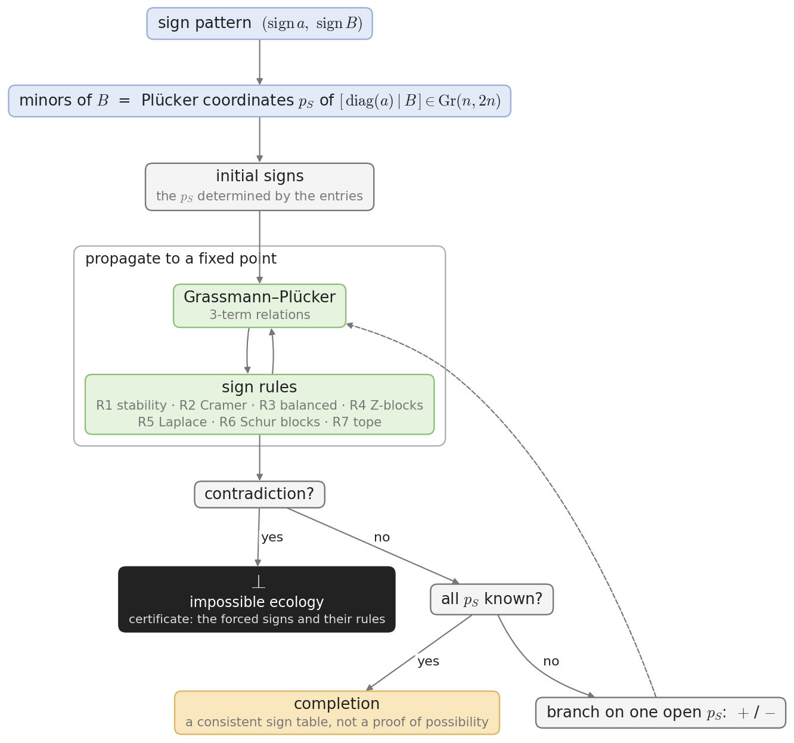
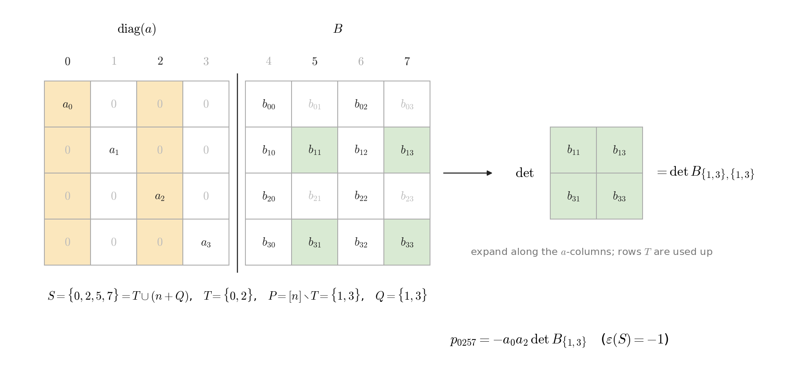
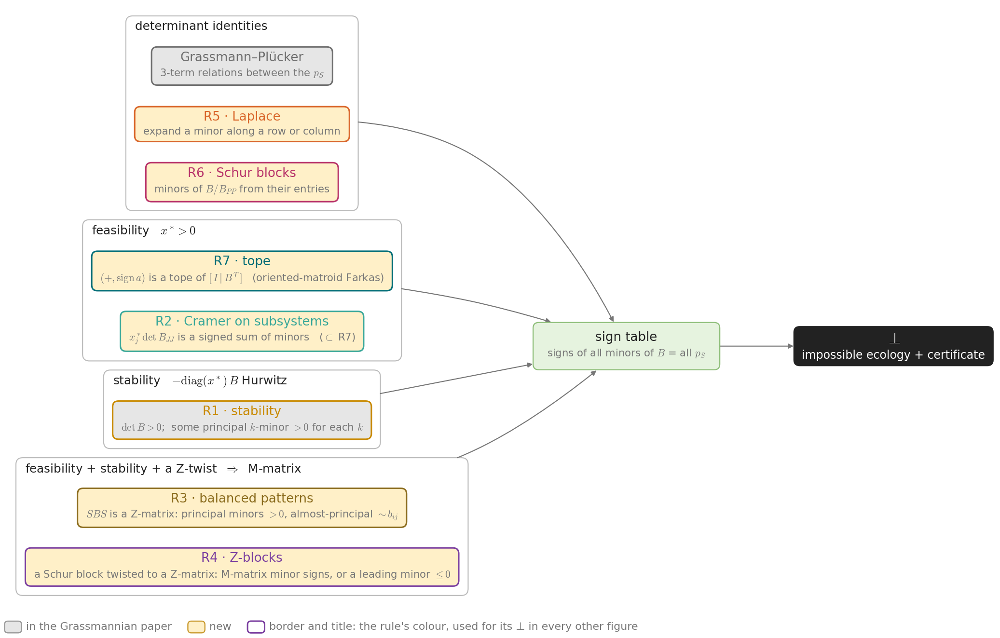
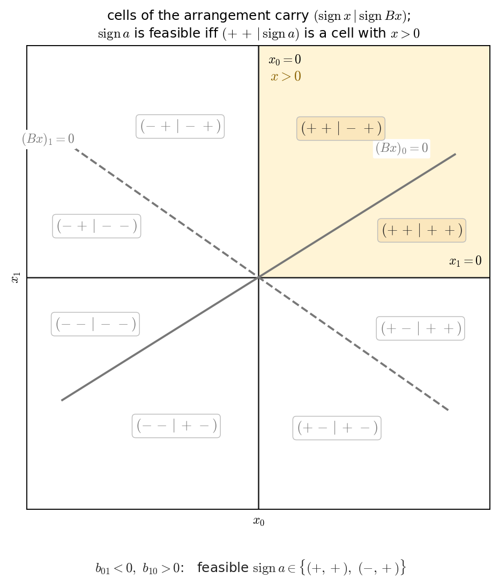
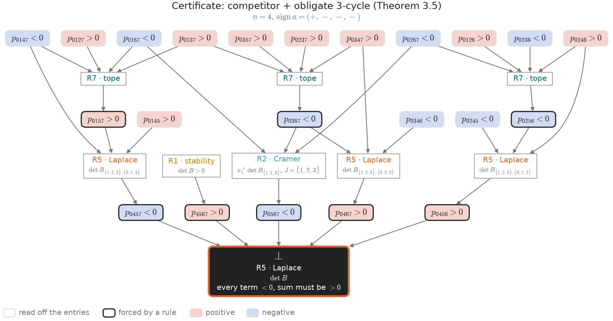
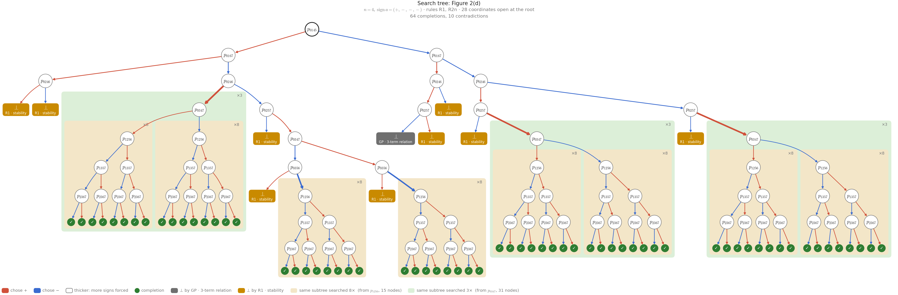

# Sign rules on the ecological Grassmannian

This document is the full account of `signrules`: how a sign pattern becomes a table of signs, what each
rule says and why it is sound, how certificates are made and checked, and what the package proves. The
[README](../README.md) covers installing and running it.

**Sources.** The package extends the oriented-matroid sign completion of [1] = Çelik, Haas, Scholten, Wang,
Zucal, *Strata of ecological coexistence via Grassmannians*, Ann. Comb. 2026 (arXiv:2509.00165, implemented
there in Maple) with the Z-/M-matrix and Schur-complement arguments of [2] = Çelik, Isoldi, Portakal, Zucal,
*Stable coexistence in ecologies and games*, arXiv:2609.09286, read as propagation rules; this is the
refinement suggested at the end of Section 3 of [2]. Theorem, Lemma and Figure numbers 2.x–3.x refer to [2].
Meng et al. is Y. Meng, S. Horvát, C. D. Modes, P. A. Haas, *Impossible ecologies*, Cell Systems 16 (2025)
101297. A write-up of the rules with precise statements and soundness proofs is in preparation.

**What is new relative to [1].** [1] propagates the 3-term Grassmann–Plücker relations with weak stability
(R1) and Cramer's rule on the full system (R2n). This package adds the arguments of [2] as rules (R2, R3,
R5; R4 and R6 too, now subsumed and idle), two new rules (R7, the oriented-matroid Farkas lemma, and R8, a
real eigenvalue), a machine certificate for every kill with an independent replay checker, and a faster
search. With them every candidate of the four-, five- and six-species classifications is decided (§6).

**Scope.** Everything here is at the level of signs. A pattern that the rules *kill* is proved impossible
(the rules are sound, §7). A pattern that survives is merely not decided by sign propagation; that it is
*possible* needs a certificate of another kind, a matrix with a stable feasible equilibrium. The package
ships such certificates for every four-species pattern and every five- and six-species candidate that the
rules leave open (§6.3); they come from tropical witnesses, the subject of a second paper.

**Contents.**
[1. The dictionary](#1-the-dictionary-minors-of-b-are-plücker-coordinates) ·
[2. Chirotope propagation](#2-chirotope-propagation) ·
[3. The rules](#3-the-rules) ·
[4. Certificates and replay](#4-certificates-and-replay) ·
[5. The search](#5-the-search) ·
[6. Results](#6-results) ·
[7. Soundness checks](#7-soundness-checks) ·
[8. Limitations](#8-limitations) ·
[9. Layout of the repository](#9-layout-of-the-repository) ·
[Appendix: R4 and R6 are subsumed](#appendix-r4-and-r6-are-subsumed)



*One run of `complete(Ecology(a, B))`.*

**Reading the figures.** A sign is a Plücker coordinate $p_S$ of
$[\operatorname{diag}(\mathbf a)\,|\,\mathbf B]\in\mathrm{Gr}(n,2n)$, written $p_{0257}>0$. Red means positive
and blue negative, everywhere: entries of $\mathbf B$ (competition / mutualism), coordinates, and the sign
chosen on a branch of a search tree. The border of a coordinate says where its sign came from: thin grey,
read off the entries; black, forced by a rule; dashed black, a branch choice. A contradiction is a black
$\bot$. Each rule has a hue of its own; nothing else is coloured. All labels are generated from the run.
Species and columns are numbered from 0 (the papers number from 1).

## 1. The dictionary: minors of B are Plücker coordinates



Write $M = [\operatorname{diag}(\mathbf a)\,|\,\mathbf B] \in \mathbb R^{n\times 2n}$, columns
$0,\dots,n-1$ for $\operatorname{diag}(\mathbf a)$ and $n,\dots,2n-1$ for $\mathbf B$.
A basis $S \subset \{0,\dots,2n-1\}$ splits as $S = T_a \cup (n + Q)$; put $P = [n]\setminus T_a$.
Laplace expansion along the $\operatorname{diag}(\mathbf a)$ columns gives

$$p_S \;=\; \varepsilon(S)\,\Big(\prod_{j\in T_a} a_j\Big)\,\det \mathbf B_{P,Q},
\qquad \varepsilon(S) = (-1)^{\sum_{j\in T_a} j \;-\; \binom{|T_a|}{2}} .$$

So the $\binom{2n}{n}$ Plücker coordinates are exactly the minors of $\mathbf B$ with
$|P| = |Q|$ (all sizes, including the empty minor $p_{[n]} = \prod a_j$ and $\det\mathbf B$),
each with a sign that is known once the signs of $\mathbf a$ are fixed. In particular:

| object of the proofs | Plücker coordinate |
|---|---|
| principal minor $\det\mathbf B_{II}$ | $p_{[I^c,\,n+I]}$ (eq. (20) of [1]) |
| Schur complement entry $(\mathbf B/\mathbf B_{PP})_{ij}$ | $\det\mathbf B_{(P,i),(P,j)} / \det\mathbf B_{PP}$ |
| minor of a Schur complement $\det(\mathbf B/\mathbf B_{PP})_{I,J}$ | $\det\mathbf B_{(P,I),(P,J)}/\det\mathbf B_{PP}$ (quotient formula) |
| cofactor $(\operatorname{adj}\mathbf B)_{ij}$ | $\pm\det\mathbf B_{[n]\setminus j,\,[n]\setminus i}$ |
| Cramer numerator $x_i^\star \det\mathbf B$ | $\sum_j \pm\, a_j \det\mathbf B_{[n]\setminus j,[n]\setminus i}$ (the feasibility inequality (17) of [1]) |

`plucker_index.py` implements this translation; `PluckerIndex.check_conventions()` verifies it numerically,
and the tests check it for $n \le 4$. Row and column order matter for the sign: the quotient formula and
"a Schur complement of an M-matrix is an M-matrix" refer to the order $(P, i)$, and the code converts to
sorted order with `merge_sign`. In the code, sign tables are flat lists indexed by basis id (`+1`, `-1`,
`UNKNOWN = 0`), and `eco._minor_key[(P, Q)] = (S, c)` gives `sign(det B_PQ) = c · chi[S]`.

The initial table of `Ecology.initial_table()` holds the sign of every minor whose permutation expansion has
monomials of a single sign. For $n=4$ this fixes 38–41 of the 70 coordinates; the partial assignment
$\chi(\sigma)$ of [1] is the subset of size $n^2+1$.

## 2. Chirotope propagation

For every $(n-2)$-set $C$ and $a<b<c<d$ outside $C$,
$p_{abC}\,p_{cdC} - p_{acC}\,p_{bdC} + p_{adC}\,p_{bcC} = 0$. With all coordinates nonzero the three terms
cannot share a sign, so two agreeing known terms force the third (`chirotope.py`). For uniform chirotopes
the 3-term relations imply the full chirotope axioms (Björner–Las Vergnas–Sturmfels–White–Ziegler,
Thm 3.6.2), so a complete table passing the 3-term test is the chirotope of an oriented matroid, though not
necessarily a *realizable* one; sign propagation cannot detect realizability. What the rules add is mainly
inequality information (Perron–Frobenius, positivity of $\mathbf x^\star$).

## 3. The rules



*Hypotheses (left) → rules (middle) → the shared sign table (right). Grey: already in [1]; yellow: new;
dotted: R4 and R6, subsumed by the others (Appendix).*

Standing hypotheses: $\mathbf x^\star = \mathbf B^{-1}\mathbf a > 0$, $J = -\operatorname{diag}
(\mathbf x^\star)\mathbf B$ Hurwitz, no vanishing Plücker coordinate. Throughout,
$\mathbf w_J := \mathbf a_J - \mathbf B_{J,J^c}\mathbf x^\star_{J^c}$ is the right-hand side of the
rows $J$ of $\mathbf B\mathbf x^\star = \mathbf a$ after moving the other species across; its sign
is known whenever $a_k$ and all $-b_{kr}$, $r\notin J$, agree. Each rule raises a `Conflict`, forces some
signs (logged with the rule and its premises, which makes the certificate), or does nothing (`rules.py`).

**R1: stability.** $\det\mathbf B > 0$ (coefficient $c_0$), and for each size $k$ the coefficient
$c_{n-k} = \sum_{|I|=k} x^\star_I \det\mathbf B_{II}$ is positive, so some principal $k$-minor is
positive (weak stability in the sense of [1]). This is exactly the stability content of [1].

**R2: subsystem Cramer rule.** $\mathbf B_{JJ}\mathbf x^\star_J = \mathbf w_J$, hence
$x_j^\star\det\mathbf B_{JJ} = \sum_{k\in J}\operatorname{cof}_{kj}(\mathbf B_{JJ})\,w_k$ must have
the sign of $\det\mathbf B_{JJ}$. $J=[n]$ is plain feasibility; smaller $J$ is the mechanism of
Theorem 3.2 ($\mathbf B_{JJ}\mathbf x_J < 0$ for the obligate group). `R2n` restricts to $J = [n]$
and reproduces [1].

**R3: balanced patterns.** If the interaction graph is balanced (a signature
$\mathbf s\in\{\pm1\}^n$ with $s_is_jb_{ij}<0$ for $i\ne j$, e.g. two competing mutualistic groups),
$S\mathbf B S$ is a Z-matrix and $-SJS = \operatorname{diag}(\mathbf x^\star)S\mathbf B S$ is a
Z-matrix with eigenvalues in the open right half-plane, hence a nonsingular M-matrix. Therefore all
principal minors of $\mathbf B$ are positive and, since Schur complements of M-matrices are
M-matrices, every almost-principal minor $\det\mathbf B_{(I,i),(I,j)}$ has the sign of $b_{ij}$.
For $n=4$ this fixes 64 of the 70 Plücker signs (Theorems 3.1, 3.2). For balanced patterns weak stability
already implies Hurwitz stability, because the eigenvalue of minimal real part of a Z-matrix is real.


**R4: Z-semipositivity on Schur blocks** (subsumed, idle by default). For disjoint $P, Q$, the block
$D = (\mathbf B/\mathbf B_{PP})_{QQ}$ satisfies $D\,\mathbf x^\star_Q = \mathbf A_Q$ with
$\mathbf A_Q = \mathbf w_Q - \mathbf B_{QP}\mathbf B_{PP}^{-1}\mathbf w_P$ (Cramer again: its
entries are signed sums of Plücker coordinates over $\det\mathbf B_{PP}$). If a row-sign twist $S$
and a column permutation $\sigma$ make $SDP_\sigma$ a Z-matrix with positive diagonal (each row of
$D$ has exactly one entry of one sign and the exceptional positions form a permutation), then:

* $S\mathbf A_Q > 0$: $SDP_\sigma$ is a nonsingular M-matrix (semipositivity), so all its principal
  minors are positive and all almost-principal minors negative;
* $S\mathbf A_Q < 0$: by Collatz–Wielandt $SDP_\sigma$ has a negative real eigenvalue, so it is
  not an M-matrix and *no* ordering of $Q$ has all leading principal minors positive (for a
  $2\times2$ block: its determinant is negative).

Minors of $D$ are minors of $\mathbf B$ divided by $\det\mathbf B_{PP}$, so these are Plücker
constraints. $P=\emptyset$, $Q=[n]$, $\sigma$ the prey map and $S=-I$ is Theorem 3.4; with the
first species kept aside it is Theorems 3.5–3.6; the $2\times2$ blocks of Lemmas 3.8–3.10 are the
not-M case.


**R5: Laplace expansion** of every minor of $\mathbf B$ along every row and column.

**R6: Schur blocks** (subsumed, idle by default). The sign of a minor of $D$ when all permutation
monomials in its entries agree (the "$\det C = c_{11}c_{44}+c_{14}c_{41} > 0$" step of Lemma 3.10), and the
rows of $D\mathbf x_Q = \mathbf A_Q$ with $\mathbf x_Q > 0$ (the "$(C)_{21}$ is forced negative" step).

**R7: tope (oriented-matroid Farkas lemma).** Row $i$ of $\mathbf B\mathbf x=\mathbf a$ is
$\langle\mathbf b_i,\mathbf x\rangle=a_i$, so the sign vectors $(\operatorname{sign}\mathbf x,\operatorname{sign}\mathbf B\mathbf x)$
are exactly the covectors of the oriented matroid of $N=[I\,|\,\mathbf B^{\!\top}]$, whose chirotope is
$\chi_N(T\cup(n+Q))=\varepsilon(T)\,\operatorname{sign}\det\mathbf B_{Q,P}$, $P=[n]\setminus T$, again minors of
$\mathbf B$. Feasibility says that $(+^n,\operatorname{sign}\mathbf a)$ is a tope, i.e. orthogonal to every
circuit. In the uniform case every $(n+1)$-subset $C=\{e_0<\dots<e_n\}$ is a circuit with
$C(e_k)=(-1)^k\chi_N(C\setminus e_k)$, and orthogonality means the $n+1$ products $T(e_k)C(e_k)$
are not all equal. This is the *complete* sign-level content of $\mathbf x^\star>0$ (Bland–Las Vergnas):
R2 is the special case of the circuits supported on one row subset, and on the $n=3$ census R7 is
strictly stronger on 38 of 512 patterns. It costs $\binom{2n}{n+1}$ checks (210 at $n=5$).



**R8: real eigenvalue.** If a twist $s$ and a permutation $\sigma\neq\mathrm{id}$
make $S\mathbf BP_\sigma$ a Z-matrix with $s\cdot\mathbf a>0$ (R4 on the whole matrix, M-matrix case),
or with $s_ia_i<0$ for exactly one species and $\sigma$ having an even number of cycles,
the pattern is impossible: the Jacobian has a positive real eigenvalue. With $X=\operatorname{diag}\mathbf x^\star$,
$D_t=S(\mathbf BX+tI)P_\sigma$ is a Z-matrix for every $t\ge0$ (the term $tSP_\sigma$ only adds $-t$
off the diagonal on the species $\sigma$ moves, where $s=-1$, and $+t$ on the diagonal at fixed points).
It is a nonsingular M-matrix at $t=0$, and $D_t\mathbf 1_N\le0$ for large $t$, where $\mathbf 1_N$ is the
indicator of the moved species. So its least real eigenvalue crosses $0$ at some $t_1>0$, where
$\mathbf BX+t_1I$ is singular, and $t_1$ is an eigenvalue of $-X\mathbf B$. This is a statement about
eigenvalues, not coefficients: R1 cannot see it.
With one wrong growth sign, $D_0$ is still a nonsingular M-matrix: its block off that species has
positive row sums, hence positive principal minors, and $\det D_0=(-1)^k\det\mathbf B\det X>0$ for
$k$ even under R1; so all leading principal minors are positive when the wrong species comes last
(case (d) of §6.4).

## 4. Certificates and replay

Every forced sign is logged with the rule that forced it and the coordinates whose signs the rule used, and
the final contradiction records its premises. The **certificate** of a kill is the backward slice of that
record: only the steps the contradiction depends on. `write_certificate(eco, result, "cert")` draws it as a
DAG (`cert.png`, `cert.pdf` and a plain-text `cert.dot`; Graphviz layout, matplotlib typesetting).

Below, the machine proof of Theorem 3.5 for a competitor plus an obligate 3-cycle: three circuits (R7), each
eliminating one species of the cycle between two of its rows, fix three almost-principal $2$-minors of the
cycle; Cramer's rule on the cycle's subsystem (R2), with the competitor moved to the right-hand side, makes
$p_{0567}$ (the principal minor on the cycle) negative; three Laplace expansions (R5) fix the minors
$\det\mathbf B_{234,[4]\setminus j}$, and the expansion of $\det\mathbf B = p_{4567}$ along the competitor's
row then has every term negative, contradicting $p_{4567}>0$ (R1). ([2] reads the first four signs off the
M-matrix of the Z-block, rule R4.)



**Independent replay.** A kill is accepted only if its certificate replays: `replay.py` starts from the
signs read off the entries and re-derives each step from the identity or inequality the step names (a
3-term relation, a Cramer or Laplace expansion, a coefficient of the characteristic polynomial, a minor of a
balanced pattern, a circuit, the Z-twist of R8, or a minor of a twisted Schur block), applied to the explicit
minors involved, and then checks that the final conflict is one. It shares no code with the engine. A
malformed step fails the replay. `replay_kill(eco, result)` replays one pattern;
`scripts/replay_certificates.py n --tamper` replays a whole list and checks that flipping any single step
makes the replay fail.

**Completions.** The same record is kept along every branch: `result.derivations[k]` holds, for the $k$-th
completion, the branch choices and every sign forced on the way, and
`write_completion(eco, result, "completion", index=k)` draws it as a stack of bands, one per branch choice.
Below, one of the 64 completions of Figure 2(d) under `R1,R2n`: seven branch choices, the third of which
forces 17 signs through the 3-term relations.


## 5. The search

`search.complete` alternates propagation to a fixed point with branching on an open sign. The fixed point
is computed by `engine.py`: each rule is split into small monotone propagators (one per 3-term relation,
signed sum of R1/R2/R5, circuit of R7, Schur block of R4/R6), every coordinate knows the propagators that
read it, and after a branch choice only those touching changed coordinates run, cheap ones first.
Monotonicity makes the fixed point independent of the order, so verdicts and completions are those of a
full sweep (`engine="sweep"`), 5–9 times faster on the $n=4$ searches.

**Search trees.** `complete(eco, record_tree=True)` records every node: the coordinate it branches on, the
sign chosen, how many signs propagation then forced and how many stay open, and how it ended.
`search_tree_text` prints the tree, `write_search_tree` draws it with Graphviz, `treeplot.py` draws large
trees without Graphviz, and `signrules tree` writes an interactive HTML viewer. Edges are red for $+$ and
blue for $-$, thicker the more signs were forced; leaves are completions (green), contradictions ($\bot$ in
the colour of the rule) or unexplored subtrees (grey). Subtrees that the search visits several times are
boxed with their multiplicity. Below, Figure 2(d) under `R1,R2n` with `engine="sweep", branching="first"`:
137 nodes, 64 completions, 10 contradictions; the same 15-node subtree on $p_{1256}, p_{1357}, p_{2367}$
appears eight times, so those three coordinates are free whatever was chosen before.



**Options** (none changes a verdict or the set of completions):

* `branching="conflict"` (the default; as VSIDS / dom-wdeg): every conflict bumps the signs among its
  premises, and the search branches on the open sign of highest activity. On the $n=6$ extension screen
  (first completion, node limit 20,000) it visits 16,034 nodes against 39,062 for `"constrained"` (the
  open sign read by the most propagators).
* `probe="root"` or `"all"`: failed-literal probing. Every open sign is set to each value on a copy and
  propagated; a conflict on one side forces the other. Under `R1,R2n` it turns the S-a search kill into a
  root kill. With all rules it adds nothing at the root on the $n=4$ census, the $n=5$ kills, or the ten
  extension candidates that R1–R7 leave open (three at $n=5$, seven at $n=6$; R8 kills them). At every node
  it removes all dead branches of the hardest $n=6$ candidate (117 nodes against 20,000), at about
  2 × (open signs) fixed points per node.
* `symmetry=True` (`symmetry.py`): a relabelling $\pi$ with $a_{\pi(i)} = a_i$, $b_{\pi(i)\pi(j)} = b_{ij}$
  maps realisations to realisations and acts on the table by
  $\det \mathbf B_{\pi P,\pi Q} = \mathrm{sgn}(\pi|_P)\,\mathrm{sgn}(\pi|_Q) \det \mathbf B_{P,Q}$; every rule
  commutes with this stabilizer $G$. The search uses SBDS (Gent–Smith 2000), and `result.completions` holds
  one completion per $G$-orbit (`symmetry.expand_orbits` recovers the rest). Under `R1,R2n`, S-d
  ($|G|=2$) drops from 131 to 68 nodes and S-e ($|G|=8$) from 131 to 37. Off by default: a search stopped
  at the first completion barely gains, and the check costs up to 20% per node.
* `seed=k`: a random branch order, so `max_completions=1` returns a random completion.
* `idle`, `root_only`, `stats`, `engine`: for the ablations (Appendix); see the docstring of `complete`.

## 6. Results

### 6.1 Four species

`uv run python scripts/impossible_eleven.py` proves the eleven four-species candidates of Meng et al.
impossible at the root, in milliseconds each. With `--engine sweep --idle ""` (R4 and R6 running) the kill
logs follow the proofs of [2] closely (R3 for the symmetric patterns, R4 with the prey permutation for the
cycle patterns, R4/R6 Schur steps for Lemmas 3.8–3.10); with the default rules the kills go through R7 and
R2 instead. The number of completions under each rule set reproduces the numbers quoted at the end of §3
of [2]:

| rules | S-a | S-b | S-c | S-d | S-e | A-a | A-b | A-c | A-d | A-e | A-f |
|---|---|---|---|---|---|---|---|---|---|---|---|
| none (chirotope only) | 21048 | 21048 | 21048 | 21048 | 21048 | 41050 | 21048 | 41050 | 21048 | 41050 | 21048 |
| `R1,R2n` (= [1]) | 0 | 0 | 0 | 64 | 64 | 1996 | 15512 | 1528 | 15508 | 1996 | 15512 |
| `R1,R2` | 0 | 0 | 0 | 0 | 0 | 0 | 0 | 320 | 15508 | 718 | 3046 |
| all | 0 | 0 | 0 | 0 | 0 | 0 | 0 | 0 | 0 | 0 | 0 |

(S-a … S-e: Figure 2 (a)–(e) of [2]; A-a … A-f: Figure 3 (a)–(f).) In the `R1,R2n` row every completion of
S-d has $\chi_{1278}=-$, of S-e $\chi_{1278}=+$, of A-a $\chi_{1678}=+$, of A-c $\chi_{1567}=-$ (coordinates
numbered from 1, as in [2]), exactly as stated there.

**The census.** Every one of the 3044 four-species patterns up to relabelling is decided: 715 are killed at
the root (11 non-trivial, the eleven above) and each of the other 2329 has a certificate of possibility
(`signrules.data.census(4)`; certificates as in §6.3). An exhaustive run over all $n=2$ and $n=3$ patterns kills exactly the trivial ones plus the four known
non-trivial classes (9 labelings at $n=3$), never kills a pattern that random sampling realizes, and leaves
the six rare irreducible $n=3$ patterns of Table 2 of [1] open (their sample points are feasible and stable).

### 6.2 Five species: the exhaustive root screen

`scripts/screen_all.py` enumerates all 248,436 non-trivial five-species patterns up to relabeling (the count
of Meng et al.) and runs root propagation on each. Under R1–R6 (`--rules R1,R2,R3,R4,R5,R6`, about 100
CPU-minutes) it kills 21; R8 kills three more (`parity_k2` and the two `r8_pairs_benefactor_*` presets),
24 in all. The 21 are recorded in `data/n5/killed_patterns.json` and summarized in
`data/n5/screen_summary.md`:

* 8 symmetric ones: exactly the $n=5$ content of Theorems 3.1–3.2 (obligate mutualism; the $1|4$
  and the six $2|3$ competing-groups patterns with an obligate group);
* 3 covered by Theorems 3.4–3.6 (obligate 5-cycle; competitor + 4-cycle; super-predator + 4-cycle);
* 10 covered by no theorem of [2]: an obligate pair or 3-cycle plus growing universal predators (the parity
  family), an obligate 3-cycle plus an obligate pair (and two variants with one growth rate flipped), and a
  growing competitor attached to a pair, a 3-cycle or a chain. R1 with R7 alone kills all ten at the root;
  R1 with R2 only two.

In every killed pattern each species benefits from none, exactly one, or all of the others (or exactly its
own group in the balanced cases). Meng et al. report an upper bound of 30 candidates (their Fig. S3); §6.3
sharpens it to exactly 24.

### 6.3 Extension screens: five and six species

**Deletion lemma** (`screen.py`): if a one-species deletion of a non-trivial pattern is possible, so is the
pattern. So a non-trivial impossible n-species pattern is a one-species extension of a non-trivial
impossible (n−1)-class, or all its deletions are trivial (the obligate derangement family).
`signrules screen n` generates both, keeps the classes whose deletions are all impossible or trivial, and
runs the rules. Every candidate the rules leave open has a certificate of possibility: a rational matrix
$C$ with the signs of $\mathbf B$ whose row sums have the signs of $\mathbf a$, so that $\mathbf a = C\mathbf 1$
makes $\mathbf x^\star = \mathbf 1$ an equilibrium, and whose eigenvalues all have positive real part, checked by
the Routh–Hurwitz criterion in exact rational arithmetic (`signrules.possible`). The shipped certificates
are tropical witnesses, $c_{ij} = b_{ij}T^{-u_{ij}}$ with integer exponents $u_{ij}$ and an integer $T$.

| n | base | candidates | killed at the root | certified possible |
|---|---|---|---|---|
| 5 | the 11 non-trivial impossible $n=4$ classes (complete: §6.1) | 83 | 24 | 59 |
| 6 | the 24 impossible $n=5$ classes | 143 | 41 | 102 |

So exactly 24 five-species and 41 six-species patterns are impossible. `signrules verify` checks the whole
chain from the shipped data: the four-species census, the candidate lists rebuilt by the deletion lemma, every
kill redone and replayed, and every certificate of possibility. Ten of the kills need R8 (three at $n=5$, seven at $n=6$); seven of
those are R8 with one wrong growth sign (case (d) of §6.4): two mutualistic pairs plus universal
beneficiaries (`parity_k2` with one growth sign flipped, and their $n=6$ extensions) and an obligate
3-cycle + mutualistic pair + universal beneficiary.

### 6.4 Infinite families

Reading the certificates of the $n=5$ kills suggests statements valid for all $n$, all consequences of one
M-matrix (`scripts/families.py`). Let $\sigma$ be a permutation of $[n]$ with fixed set $F$ and $k$ cycles
on $N=[n]\setminus F$; species in $F$ benefit from everybody and have $a_i>0$; species in $N$ are obligate,
benefit only from $\sigma(i)$ and are harmed by everyone else. With $s=+1$ on $F$, $-1$ on $N$,
$D=S\mathbf BP_\sigma$ is a Z-matrix with $D(P_\sigma^{-1}\mathbf x^\star)=S\mathbf a>0$, hence a nonsingular
M-matrix.

* **(a) all species obligate** ($F=\emptyset$, any $k$): $\mathbf B^{-1}=P_\sigma D^{-1}S$ gives
  $(\mathbf B^{-1})_{jj}=-(D^{-1})_{\sigma^{-1}j,j}\le0$, so every principal $(n-1)$-minor has the sign
  opposite to $\det\mathbf B$ and $c_1$ has the sign of $-\det\mathbf B$: impossible. ($k=1$: Theorem 3.4.)
* **(b) $k$ odd** (any $F$): $\det D=(-1)^k\det\mathbf B>0$ contradicts $\det\mathbf B>0$: impossible.
  ($k=1$, $|F|=1$: Theorem 3.6.)
* **(c) every $\sigma\neq\mathrm{id}$**, any $F$: the Jacobian has a positive real eigenvalue (R8), so the
  pattern is impossible. This settles the even-$k$ cases with fixed points, which R1–R7 leave open at the
  root. The smallest is `parity_k2` at $n=5$: two obligate pairs and one universal beneficiary.
* **(d) one wrong growth sign, $k$ even**: the conclusion of (c) persists (proof under R8).

R1 with R4 kills the instances of (a) and (b) for $n\le7$ at the root (`scripts/families.py --nmax 7`), and
R8 kills every instance. The hypothesis of R8 is exactly this family: at $n=5$, ten of the 248,436 patterns
satisfy it, six with $s\cdot\mathbf a>0$ (the screen kills #2, #4, #7, #17, #21 and `parity_k2`) and four
under (d): #15, #16 (already killed by R1) and the two `r8_pairs_benefactor_*` presets that R1–R7 leave open.

## 7. Soundness checks

* `check_conventions`: the Plücker/minor dictionary on random matrices.
* The initial table never disagrees with the numeric chirotope of a random system.
* For random feasible, stable systems with $n=3,4$ (`tests/test_soundness.py`, balanced ones included): the
  rules never reject the true complete table, and on the partial initial table they never force a sign
  different from the truth.
* `tests/test_r8.py`: R8 never fires on an $n\le4$ class that R1–R7 leave open (all of those are possible).
* Every certificate of the $n=4,5,6$ kills replays, and every certificate with a single flipped step is
  rejected (`tests/test_replay.py`).
* The exact stability check of `signrules.possible` agrees with sympy and numpy on random matrices
  (`tests/test_possible.py`).

## 8. Limitations

* Uniform chirotopes only: a vanishing Plücker coordinate (e.g. a zero almost-principal minor) is outside
  the search, as in [1].
* Sign level only: a surviving completion is not a certificate of possibility.
* The orthant is fixed to $\mathbb R^n_{>0}$. The sign torus $\mathbf B\mapsto S\mathbf BS$, $\mathbf a\mapsto S\mathbf a$
  is a reorientation moving $\mathbf x^\star$ to $S\mathbf x^\star$, so the natural object is a (chirotope, tope)
  pair; R7 and R2 generalise verbatim to an arbitrary orthant.
* Symmetry: relabeling is used in the $n=5$ screen and, through the pattern stabilizer, inside the search;
  the sign torus acting on (pattern, orthant) pairs could shrink the enumeration further.

## 9. Layout of the repository

```
signrules/
  plucker_index.py, chirotope.py     minors of B <-> Plücker coordinates; 3-term Grassmann–Plücker propagation
  rules.py, engine.py, search.py     the rules (Ecology, Conflict); the trigger-driven fixed point; complete()
  certificate.py, replay.py          the certificate of a kill or completion; its independent replay
  possible.py                        exact check of a certificate of possibility
  symmetry.py                        the pattern's relabelling stabilizer, used inside the search
  labels.py, style.py, gvrender.py, treeplot.py, treeview.py   drawings and the HTML tree viewer
  cli.py, report.py, livesearch.py   the signrules command, the verdict, the live dashboard
  editor.py, network.py              the app and the interaction network
  screen.py, patterns.py             the extension screen; the named patterns and the parsers
  data/                              the extension screens and the certificates of possibility (n = 5, 6)
scripts/              reproduce the numbers of the papers (README, "Reproducing the papers")
data/                 records of the scripts: rule ablations, R4 subsumption, rule ladder, the n = 5 root screen
tests/                conventions, soundness, golden search trees, replay, possibility certificates
docs/                 this document and its figures (with their generators)
```

## Appendix: R4 and R6 are subsumed

Under the full rule set R4 and R6 never force a sign the other rules have not set, so `complete()` *idles*
them by default (`idle="auto"`): their propagators stay registered, so the branching order, the trees and
the certificates are those of the full rule set, but they never run. `idle=()` (`signrules run --idle ''`)
runs them, and a reduced rule set that lacks the subsuming rules (say `R1,R2n,R5,R6`) runs them as before.

**Measured.** `complete(stats=True)` counts the runs, forced signs and conflicts of every rule. On the eleven
$n=4$ patterns and the 226 patterns of the $n=5,6$ extension screens, R4 and R6 run 112k and 97k times at
the root and 803k and 679k times below it without forcing a sign or raising a conflict
(`scripts/rule_ablation.py`; records in `data/rule_ablation/`). On the eleven, R6 alone forces 40 signs and
R4 alone 25; it is R7 that makes R6 redundant (under `R1,R7,R6` R6 forces nothing) and R4 nearly so.

*R6.* Part (a) can only fire on a $2\times2$ minor of $D$: a $k\times k$ matrix without zero entries
has permutation terms of both signs when $k\ge3$ (if all agreed, comparing a permutation with its
composite with a transposition gives $\operatorname{sign}(d_{ik}d_{jl})=-\operatorname{sign}(d_{il}d_{jk})$ for all
rows $i\ne j$ and columns $k\ne l$; on rows $1,2$ and columns $1,2,3$ the three conditions multiply to
a contradiction). For $2\times2$, Sylvester's identity
$\det\mathbf B_{PP}\,\det\mathbf B_{P+ij,P+kl}=\det\mathbf B_{P+i,P+k}\det\mathbf B_{P+j,P+l}-\det\mathbf B_{P+i,P+l}\det\mathbf B_{P+j,P+k}$
is the 3-term Grassmann–Plücker relation of $\mathrm{Gr}(n,2n)$ on the $(n-2)$-set
$([n]\setminus(P\cup\{i,j\}))\cup(n+P)$ and the elements $i,j,n+k,n+l$; R6(a) needs $\det\mathbf B_{PP}$
known and the two products of one sign, which is exactly when the 3-term propagator forces the third
term. Part (b): row $i$ of $D\mathbf x_Q=\mathbf A_Q$, multiplied by $\det\mathbf B_{PP}$ and with
$\mathbf w=\mathbf a-\mathbf B_{\cdot R}\mathbf x_R$ expanded, is
$\sum_{j\in Q\cup R}\det\mathbf B_{P+i,P+j}\,x_j=\sum_{r\in P+i}\pm a_r\det\mathbf B_{P+i-r,P}$,
a linear relation in $(\mathbf x,\mathbf a)$ with support of size $n+1$: the circuit of $[I\,|\,\mathbf B^{\!\top}]$
on $([n]\setminus P)\cup(n+(P+i))$, which R7 checks. R6(b) uses it with the terms lumped: $\mathbf A_i$
known means the $a$-terms agree, and $w_r$ known means $\operatorname{sign}b_{rk}=-\operatorname{sign}a_r$ for
$k\in R$, so the column-$k$ Laplace expansion of $\det\mathbf B_{P+i,P+k}$ has terms of one sign and R5
has set it to the sign the lumping assumes. Whatever R6(b) forces or refutes, R7 therefore forces or
refutes on that circuit. So on a table closed under the 3-term relations, R5 and R7, R6 is silent, also on
tables that are not realizable (`tests/test_subsumption.py` checks random partial tables).

*R4.* On the whole matrix ($P=\emptyset$, $Q=[n]$): $\sigma=\mathrm{id}$ forces $s=+1$ ($s_ib_{ii}>0$),
so $\mathbf B$ is a Z-matrix and R3 (balanced signature $\mathbf 1$) gives the same M-matrix signs; in the
not-M case $\mathbf a<0$ those signs make every term of R2's Cramer sum for $x_1\det\mathbf B$ negative,
a conflict. $\sigma\ne\mathrm{id}$ with $s\cdot\mathbf a>0$ is R8. For the M-matrix case of a block with
$P=\emptyset$ the signs follow by induction on the block size $m$ through R5 and R7 (or R2): at size $m$
an almost-principal minor of $Z=S D P_\sigma$ (rows $I$, columns $I-k+j$) has a column-$j$ Laplace
expansion whose terms are an entry $z_{ij}<0$ times a cofactor of the $(m-1)$-level M-matrix $Z_{II}$,
all of one sign (Cramer: $Z_{II}^{-1}z_{I,j}\le0$), so R5 sets it; the principal minor $\det Z_{II}$ then
is the one open term of the Cramer circuit of $x_k$ on the rows $I$, whose other terms (the
$(m-1)$-cofactors, the $a$-terms and the almost-principal minors just set) all have one sign. For
$P\ne\emptyset$ this chain needs the cofactors with a row of $P$ removed,
$\det\mathbf B_{P-r+I,\,P+\sigma(I)-k}$, which are not minors of $D$: the identity expressing them through
$D$'s cofactors is the $(m+1)$-term Grassmann–Plücker relation, which the engine propagates only for
$m=2$; and the not-M case of a proper block is a statement about leading minors (Fiedler–Pták) rather
than one signed sum. For those cases the subsumption of R4 is tested in two ways.

First, in search trees: on every table closed under the other rules in the search trees of all 512
patterns at $n=3$ (whole trees), all 3044 relabelling classes at $n=4$ (3000 nodes each: 6.9 M nodes),
19,995 random patterns at $n=5$ (2000 nodes each, 34.6 M nodes) and 2000 at $n=6$ (1000 nodes each, 2.0 M
nodes), R4 ran 169 M times and R6 106 M times without setting a sign or raising a conflict
(`scripts/rule_ablation.py --census`; the $n=3,4$ records are in `data/rule_ablation/`, and the $n=3,4$
censuses reproduce the 178/334 and 715/2329 root kills/open patterns). On 2800 tables built so that R4
applies on a Schur block with $P\ne\emptyset$ and $|Q|\in\{3,4\}$ ($n=4,5,6$; R4 does fire on them after the
3-term relations alone), R4 is silent once the other rules have run.

Second, at the level of propagation, exhaustively per $n$ (`scripts/r4_subsumption.py`). The propagators
are monotone, so the closure of any table on which R4 applies contains the closure of R4's *premises*: the
minimal table with $\det\mathbf B_{PP}$, the entries of $D$ along the twist, the minors of the reduced
right-hand side and $b_{rt}=-a_r$ ($t\in R$) set. It suffices to close the premises under the other rules
and compare with R4's conclusions. A configuration is a block $(P,Q)$ (initial segments, up to
relabelling), a twist $\sigma$, the case, the sign of $\det\mathbf B_{PP}$ and $\mathbf a$. Here R4 turns out
*not* to be subsumed at the fixed point: on the pattern $\mathbf a=(-,+,+,+,+)$,
$\mathbf B=\bigl(\begin{smallmatrix}+&-&-&-&+\\+&+&-&+&-\\+&+&+&-&-\\+&-&+&+&-\\+&+&+&+&+\end{smallmatrix}\bigr)$
with $Q=\{0,1,2,3\}$, $\sigma=(1\,2\,3)$ and the not-M case, the table with the $1\times1$, $2\times2$
and $4\times4$ leading minors of $Z$ positive is consistent under the other rules with the $3\times3$
one open, and R4 sets it negative. What holds is subsumption *one branching step deeper*: a conclusion
missing from the closure counts as *probed* when its opposite sign conflicts at the fixed point (here an
R2 Cramer conflict on all five rows). The search without R4 then refutes the wrong side at the next node,
so verdicts and completions are unchanged at the price of one dead node; the depth-first search, which
decides small minors before large ones, never even reaches such a table. Under the 3-term relations, R1
and R7: at $n=3$ all 37 applicable configurations pass at the fixed point; at $n=4$, 359 at the fixed point
and 4 by probe; at $n=5$, 2259 at the fixed point, 466 by probe, and the remaining 256 (a $2\times2$ block
with $|P|=2$, where $\det D>0$ needs the Laplace expansions of R5) at the fixed point under the full rule
set on 17,407 consistent explicit patterns; at $n=6$, with $\sigma$ up to conjugation and $\mathbf a$ up to
its centralizer, of 4164 configurations 1073 pass at the fixed point, 344 by probe, and the 744 with
$|P|\ge2$ and $|Q|\le3$ at the fixed point under the full rule set on 19,528 explicit patterns. Records in
`data/r4_subsumption/`; `tests/test_r4_subsumption.py` keeps $n=3,4$ and the pattern above.
